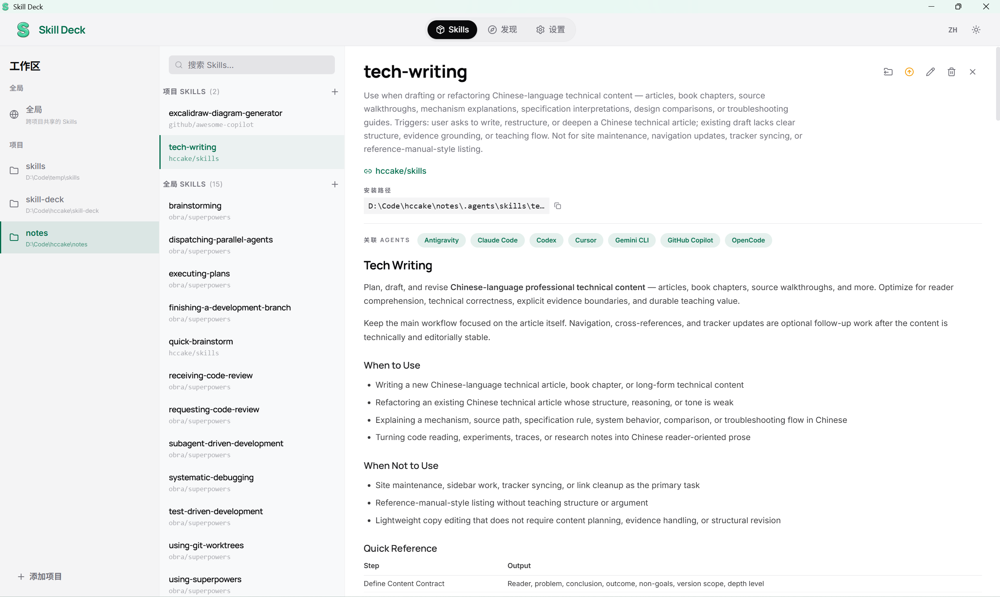
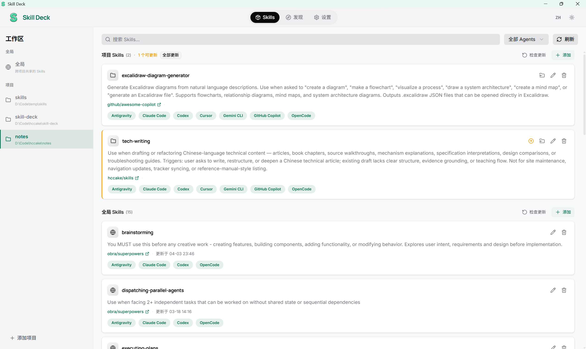
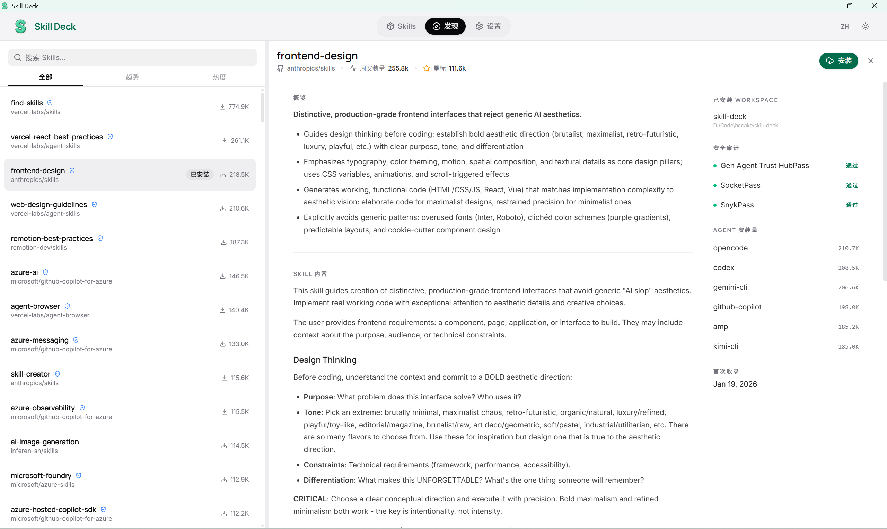
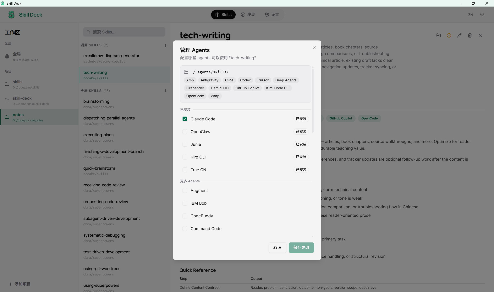
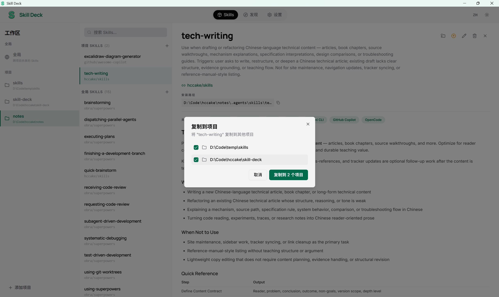

<div align="center">
  

  <h1>Skill Deck</h1>

  <p>
    <strong>跨平台的 AI Agent Skill 桌面管理工具</strong>
  </p>

  <p>
    安装和维护全局与项目 Skill，管理 Agent 关联，<br>
    通过 Skill 库复用常用内容，并对照阅读原文与简体中文译文。
  </p>

  <p>
    <a href="https://github.com/hccake/skill-deck/releases/latest">
      
    </a>
    <a href="https://github.com/hccake/skill-deck/actions/workflows/quality.yml">
      
    </a>
    <a href="LICENSE">
      
    </a>
  </p>

  <p>
    <a href="https://github.com/hccake/skill-deck/releases/latest">下载最新版本</a>
    ·
    <a href="#-快速开始">快速开始</a>
    ·
    <a href="README.md">English</a>
  </p>
</div>

---

## ✨ 核心能力

- **发现与安装**：浏览在线 Skill，查看来源、正文和已有审计信息。支持 GitHub、GitLab、普通 Git、本地目录、Well-known 地址，以及原始 `SKILL.md`、ZIP、tar 和 tar.gz 下载地址。
- **浏览与维护**：阅读、更新和移除已安装 Skill，包括仅存在于 Agent 专用目录中的安装。没有来源记录的内容仍可作为本地 Skill 管理。
- **Skill 库**：独立维护常用 Skill 集合，按优先顺序应用到全局或项目，并同步成员变化；需要修复受管理链接时，可以主动重新应用。
- **项目与 Agent**：查看全局与项目 Skill，按 Agent 筛选，调整关联关系，并将项目 Skill 复制到其他项目。支持随应用提供的 Agent 信息，也支持自行添加。
- **双语阅读**：在 Skills、库成员和发现页详情中逐段对照原文与简体中文译文。支持 Google、微软及 OpenAI 兼容服务，并可选择译文配色。
- **跨平台管理**：支持 Windows、macOS 和 Linux。Windows 用户启用 WSL 支持后，还可管理已安装 WSL 2 发行版中的 Skill。

应用提供中英文界面和浅色、深色主题，并在重新打开时恢复主窗口的尺寸、位置和最大化状态。

---

## 🖼️ 界面预览

<p align="center">
  
</p>
<p align="center"><em>浏览已安装的 Skill，查看完整内容，并检查或执行更新。</em></p>

<table>
  <tr>
    <td width="50%" align="center">
      
      <br />
      <em>查看全局与项目 Skill，并按 Agent 筛选。</em>
    </td>
    <td width="50%" align="center">
      
      <br />
      <em>浏览可安装的 Skill，并查看来源、说明和安全信息。</em>
    </td>
  </tr>
</table>

<table>
  <tr>
    <td width="50%" align="center">
      
      <br />
      <em>调整哪些 Agent 能够读取已安装的 Skill。</em>
    </td>
    <td width="50%" align="center">
      
      <br />
      <em>将项目 Skill 复制到当前或其他 Environment 中的项目。</em>
    </td>
  </tr>
</table>

---

## 📥 下载与安装

从 [GitHub Releases](https://github.com/hccake/skill-deck/releases/latest) 下载最新版本，并选择对应平台的安装包：

| 平台 | 安装包 |
|---|---|
| Windows x64 | `skill-deck_x.x.x_windows_x64-setup.exe`；稳定版另提供 `skill-deck_x.x.x_windows_x64.msi` |
| macOS Apple Silicon | `skill-deck_x.x.x_macos_aarch64.dmg` |
| macOS Intel | `skill-deck_x.x.x_macos_x64.dmg` |
| Linux x64 | `skill-deck_x.x.x_linux_amd64.deb`、`skill-deck_x.x.x_linux_x86_64.rpm` 或 `skill-deck_x.x.x_linux_amd64.AppImage` |

文件名中的 `x.x.x` 对应所选版本。Windows 预发布版本只提供 `.exe` 安装程序。

macOS 安装包目前未使用 Apple 开发者证书签名。确认下载来自本项目的 Release 页面后，若系统阻止打开，可在“系统设置 → 隐私与安全性”中选择“仍要打开”，具体步骤见 [Apple 官方说明](https://support.apple.com/zh-cn/102445)。

---

## 🚀 快速开始

### 1. 选择安装入口

在 `Skills` 页的全局或项目区域点击添加，安装向导会使用该位置；项目需要先添加到 Skill Deck。也可以在“发现”页选择 Skill 并点击安装，向导默认选择全局，用户可改选已添加项目。Windows 启用 WSL 后，先切换到目标发行版，再发起安装。

### 2. 提供 Skill 来源

从 `Skills` 页发起时，可以在线搜索或手动输入来源；从“发现”页发起时，向导会带入所选 Skill 的来源。手动输入示例：

- `https://github.com/vercel-labs/skills`
- `vercel-labs/skills`（GitHub 简写）
- `https://example.com/SKILL.md` 或 ZIP、tar 归档地址
- `/path/to/local/skill` 或 `C:\path\to\skill`（对应系统中的本地目录）

也可以直接粘贴 [`skills` CLI](https://github.com/vercel-labs/skills) 的 `skills add` 安装命令。Skill Deck 会解析其中的来源、Skill 和目标 Agent，并在安装前提供确认和调整：

```bash
npx skills add vercel-labs/agent-skills --skill web-design-guidelines -a claude-code
```

### 3. 确认并安装

选择需要安装的 Skill、关联 Agent 和安装方式，检查实际写入位置、覆盖内容及来源提示，再确认安装。跨主机下载需要确认最终主机。向导打开后，主窗口切换位置不会改变本次安装目标。

安装完成后，可在 `Skills` 页阅读正文、管理 Agent、检查更新或移除 Skill。也可以在“Skill 库”页维护独立集合，再从全局或项目区域的“管理 Skill 库”入口应用。

### 使用范围

- 没有来源记录或来源为本地目录的 Skill 保留本地管理能力，不参与远端更新检查。私有 GitHub 来源检查可以使用本机 Git 已有的凭据。
- 直接下载只支持无同名冲突的全新安装，安装后不提供更新；再次安装前需要移除现有 Skill。
- 更新保持已有 Agent 关联，确认前列出实际位置。通用内容固定更新，独立副本可以选择，链接跟随目标内容；同名库版本由对应库独立维护。
- 来源目录链接或过大的来源可能阻止更新，应用会说明原因并保留已安装内容。完整适用条件见[更新检查](./docs/update-checking.md)，安装与维护规则见[Skill 生命周期](./docs/skill-lifecycle.md)。

---

## 📚 文档与反馈

- 查看[版本记录](./CHANGELOG.md)了解各版本的用户可见变化
- 通过 [GitHub Issues](https://github.com/hccake/skill-deck/issues) 报告问题或提出建议
- 从[项目文档](./docs/README.md)了解产品行为、兼容范围和开发约定

---

## 🛠️ 开发与贡献

开发环境、依赖版本、本地运行、验证和提交方式见[贡献指南](./CONTRIBUTING.md)。Windows 开发者先完成指南中的 Worker 资源准备。

生产构建使用 `pnpm tauri build`，构建产物位于 `src-tauri/target/release/bundle/`。

---

## 📄 许可证

[Apache License 2.0](LICENSE)

---

## 🙏 致谢

- [vercel-labs/skills](https://github.com/vercel-labs/skills)：独立维护的第三方 Skill 管理工具，也是 Skill Deck 的兼容与产品参考。
- [Tauri](https://tauri.app/)：跨平台桌面应用框架。
- [Linux.do](https://linux.do/)：社区支持与反馈。
