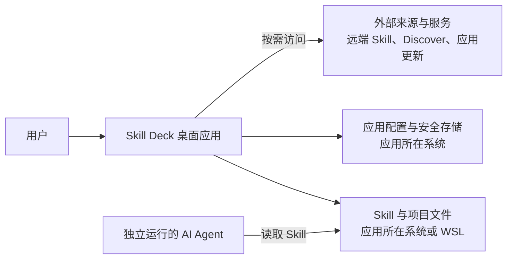
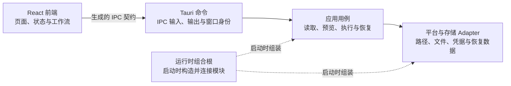

# 系统架构

Skill Deck 是一款运行在用户电脑上的跨平台桌面应用，支持 Windows、macOS 和 Linux。Skill 和项目的读取与管理在应用所在操作系统中完成；Windows 用户切换到 WSL 后，则在所选发行版中完成。浏览 Discover、获取远端 Skill 或检查更新时，应用会按需访问相应的外部服务。

系统边界、模块职责、主要调用关系、窗口与进程、平台适配模块（Adapter）、数据归属和安全保证由本文件维护。用户可见行为、领域规则和具体写入协议见相应主文档。

## 架构目标

- Windows、macOS 和 Linux 复用相同的业务用例，路径和文件操作由对应平台 Adapter 实现；
- Windows 可以把文件操作切换到用户选择的 WSL 发行版，桌面应用仍然运行在 Windows 中；
- 外部 AI Agent 独立读取约定位置中的 Skill；第三方 `skills` CLI 和 Skill Deck 使用相同的通用 Skill 存放位置和兼容的 lock 数据，各自独立管理 Skill；
- 主窗口和安装向导共享 Rust 运行时，但只获得各自工作需要的命令权限；
- React 与 Rust 使用同一份生成的进程间通信（IPC）契约；
- 安装、更新、复制、移除和管理 Agent 复用同一套预览、执行与恢复接口；
- 文件写入、凭据和外部进程分别经过适合自身风险的安全接口。

## 系统边界



在 macOS 和 Linux 上，Skill Deck 直接在当前系统中读写 Skill 与项目文件。Windows 上默认在 Windows 中执行这些文件操作；用户启用 WSL 支持并选择发行版后，相关操作转到该发行版中完成，桌面应用仍然运行在 Windows。Windows 及其系统工具负责 WSL 和发行版的安装与生命周期，完整的切换和项目访问规则见[Environment、Skill 位置与项目管理](./environments-and-projects.md)。

AI Agent 独立安装和运行，并从自身支持的目录中读取 Skill。Skill Deck 根据 Agent 的 Skill 读取路径管理通用目录和专用目录，不启动或托管 AI Agent。第三方 `skills` CLI 也独立运行，与 Skill Deck 之间没有运行时调用关系；两者的数据兼容和参考关系见[skills CLI 参考与兼容](./skills-cli-reference.md)。

应用配置保存在桌面应用所在系统中，GitHub Token 由操作系统安全存储保管；具体的数据归属见下文。

## 进程与窗口

主窗口和安装向导是同一桌面应用中的两个 WebView，加载同一套 React 应用并进入不同路由。每个 WebView 独立维护自己的前端状态，两个窗口共享一个 Rust 进程及其中的常驻模块。

两个窗口使用不同的 Tauri 窗口权限配置（capability）。主窗口和安装向导分别只能调用自身工作需要的命令。窗口权限用于限制可调用入口；实际业务条件仍由 Rust 后端判断。

Windows 主窗口开启 Tauri 的透明窗口合成，页面根布局继续使用不透明的主题背景，以减少拖动边缘缩放时的黑色闪现。

主窗口的尺寸、位置和最大化状态直接委托 `tauri-plugin-window-state` 保存与恢复，状态文件位于应用配置目录的 `.window-state.json`。应用在启动入口注册插件，限定其管理 `main` 窗口；窗口装饰、可见性、全屏状态与安装向导使用自身配置。前端不增加窗口状态插件权限，退出许可仍由现有生命周期与运行准入流程决定。平台间的窗口状态差异跟随插件实现。

安装向导如何固定本次安装目标、主窗口如何展示安装状态等用户可见行为见[产品行为与交互](./product.md)。

## 应用内部结构

下图表示典型业务请求的调用方向，并单独标出应用启动时的组装关系。完整的命令和代码依赖以源码为准。



`core` 为后端模块提供 Agent、Skill、来源和 lock 等共享类型与基础规则。它不属于请求处理流程中的某个阶段。发行版发现、连接和路径映射等平台管理命令可以直接使用 `environment` 模块；具体调用和依赖由源码维护。

### 前端模块

| 模块 | 职责 |
|---|---|
| `App.tsx`、`pages/`、`layouts/`、`components/` | 组织窗口路由、页面布局、交互和可见状态 |
| `stores/` | 保存前端快照和界面状态，协调异步请求与状态刷新 |
| `hooks/` | 连接页面与状态模块，监听后端事件并封装可复用的交互状态 |
| `workflows/` | 跨页面或对话框的预览、执行和结果归并 |
| `lifecycle/` | 协调未保存内容、关闭、退出、重启和写操作中断 |
| `lib/` | 提供前端复用的筛选、展示、操作位置和 Discover 逻辑 |
| `hooks/useTauriApi.ts`、`bindings.ts` | 提供类型安全的 IPC 调用；前后端类型绑定（bindings）由 Rust 命令和类型生成 |

前端负责展示状态、收集用户选择和协调请求。文件操作提交 `SkillLocationRef`、业务标识和必要输入，由后端解析路径并判断是否允许执行。前端快照按操作位置隔离，异步结果只有在请求编号和相关修订信息匹配时才更新当前状态。

`LibraryWorkspace` 统一维护各 Environment 的库列表、当前库、详情和成员操作状态。页面与弹窗通过它提交成员变更，区分业务命令失败、列表读取失败和未执行结果。命令失败保留上次成功快照；提交后的展示数据刷新失败，也不会重新发送已经完成的写入命令。

删除库时，工作区接收后端返回的最新库列表，再根据删除前顺序更新选中项。路由只同步已经提交的 `selectedLibraryId`。删除确认会话固定 Environment 和库 ID，弹窗不直接调用成员 IPC。

安装向导与库添加流程共享来源输入、发现状态、候选选择和跨主机确认。`useSourceDiscovery` 只接收 Environment，统一管理操作标识、克隆进度、过期响应和重试。`useLibraryAddFlow` 保存添加弹窗中的局部状态，提交结果由 `LibraryWorkspace` 统一接收。

### Rust 模块

| 模块 | 职责 |
|---|---|
| `commands/` | 维护 Tauri 命令和 IPC 类型，读取调用窗口与共享状态，组织只属于单个命令的简短流程 |
| `application/` | 维护跨命令、跨执行阶段或跨 Environment 的业务流程，并定义所需接口；具体适配和装配由运行时负责 |
| `core/` | 维护 Agent、Skill、来源、lock、配置和注册表的共享类型与基础规则 |
| `environment/` | 解析操作位置和文件系统能力，提供 Windows、Unix 与 WSL 平台适配 |
| `storage/` | 提供原子文档、兼容 lock、凭据和恢复数据的持久化适配 |
| `runtime/` | 构造并持有常驻模块，实现应用接口所需的适配器、类型别名和装配函数 |
| `models/` | 维护跨命令复用的 IPC 数据类型；单个模块独有的类型由该模块维护 |
| `error.rs` | 定义统一的 `AppError` 和失败原因枚举 |
| `background_process.rs` | 构造后台子进程，管理进程组的挂起、恢复与整树终止 |
| `test_support/` | 提供仅在测试构建中使用的工作流和 Git 夹具 |

### 运行时组装与写入许可

`RuntimeServiceGraph` 是 Rust 后端的组合根，也是 Tauri Managed State。命令从中取得长生命周期状态、共享业务流程和平台能力。只服务于单个命令的流程可以保留在命令模块中；需要复用、持有长期状态或隔离平台差异时，再提取独立模块。

`RuntimeAdmissionCoordinator` 统一协调安装会话、Skill 写入、设置、应用生命周期和应用更新的运行许可。正常运行采用单应用实例；全部持久化写入口在产生副作用前取得许可。

Skill 库的元数据文档（catalog）属于应用私有数据，由当前应用实例写入。运行时按 Environment 串行化库内容与内部恢复 I/O，崩溃一致性由原子文档、条件提交和恢复数据保证。单写者取舍见 [ADR-0010](./adr/0010-use-single-writer-library-persistence.md)。

### Skill 目录规划

相关模块分别负责目录解析、库候选和物理目录计划：

| 模块 | 输入与职责 |
|---|---|
| `application/agent_selection` | 在一次解析中生成公开选择快照，以及内部的通用目录和 Agent 安装选项目录表 |
| `application/library_candidates` | 从完整库元数据取得活动和退役成员的物理归属证据；另按库应用关系提供有序选举候选 |
| `application/scope_skill_placements` | 观察实际安装位置、合并读取关系，供读取、检查资格和变更规划复用 |
| `application/scope_skill_planning` | 使用同一次规划的目录表，将直接安装变化和库应用变化转换为物理目录计划 |
| `application/mutation` | 签发与校验预览凭据，组装变更计划，并提供完整写入任务的执行接口 |

目录观察只向已经解析的根目录追加安全目录名，不重新解释 Agent 路径或 Eve 目标。规划模块使用 `PhysicalTargetKey` 合并同一物理目录，并为每个目录生成执行条目、观察依赖和用户可见摘要。底层选举保持私有，业务流程通过直接安装或库应用接口提交变化。

Skills 读取先盘点根目录和实际 Skill 条目，再按物理身份合并实际位置，并分页读取唯一 `SKILL.md` 的 frontmatter。整根目录链接根据根链接目标匹配库，叶子目录通过“Skill 名称 + 物理目标”索引匹配；读取流程不会为 Agent 根与 Skill 名称构造不存在路径的组合，也不会为指向同一物理内容的位置重复读取或解析 frontmatter。

Native 与 WSL Adapter 在内部遵守单批数量、内容额度、并发数和累计截止时间，应用层只接收保持输入顺序的完整事实集合。进程内缓存保存已解析 frontmatter，并以 Environment、物理身份、文件指纹、Worker 修订和 Agent 注册表修订作为失效依据。单个根或唯一内容读取失败时，读取结果标记为不完整并保留其他可确认 Skill；写操作继续重新取得必要事实，不使用部分读取结果作为执行许可。

位置观察是一次调用内的数据结果。默认阅读位置、复制源资格和更新目标分别由各用例解释；只读归属查询不继承库应用的写入门禁，读取也不调用完整变更规划。通用目录是可选安装位置，实际 Agent 专用目录可以独立参与维护。

所有相关流程都提供库候选快照；没有库版本时也返回带证据的空快照。逐目录优先级和既有内容保护由[Skill 生命周期](./skill-lifecycle.md#库应用与版本选举)维护，集中规划的取舍见 [ADR-0011](./adr/0011-centralize-scope-skill-version-election.md)。

生产执行接口以完整 `ExecutionUnit` 为单位准备和提交，逐条目录驱动只用于测试。`RuntimePlanExecutor` 协调任务顺序、结果和恢复，Environment Adapter 完成目标文件系统操作。执行期复核与事务边界见[执行与恢复](./execution-and-recovery.md)。

### Skill 库与来源更新

| 模块 | 职责 |
|---|---|
| `SkillLibraryModule` | 库元数据、成员内容、来源记录和库内部事务 |
| `LibraryUpdateService` | 同名成员内容更新与来源重新获取 |
| `LibraryMembershipModule` | 成员新增、退役、重新激活、跨 Scope 同步、恢复和清理；持有写许可、内容会话和目标状态依赖 |
| `LibraryApplicationModule` | 单个 Scope 的库顺序、Agent 选择、应用记录和未完成操作 |
| `ScopeSkillPlanner` | 生成物理目录计划，检查跨 Scope 目标冲突 |

成员命令只解析 IPC 输入并调用 `LibraryMembershipModule`。成员模块通过上述业务接口协作，来源获取、目录选举和平台文件操作由各自模块实现。

`ApplicationRegistry` 是库应用记录的唯一持久化接口，提供按 Scope 读取、条件保存和按 Environment 枚举。枚举直接读取应用记录存储，项目列表只补充展示信息；坏记录和不可访问记录独立报告，不把它们当成不存在。

库使用状态按 Scope 批量读取并聚合，读取次数不随库数量增长。结果区分已经生效的位置和未完成操作中的引用，并携带盘点完整性。成员同步、继续处理和清理协议见[执行与恢复](./execution-and-recovery.md#库应用事务)。

`SkillSourceModule` 按保存的来源重新取得完整内容，并合并等价来源请求。直接安装 Skill 和库成员分别提供绑定目标的记录适配器；更新证据模块通过 `snapshot(names)` 在远端请求前后读取来源记录，不解释 Scope、库身份或持久化格式。

记录适配器逐项返回记录缺失、无法解释或可以更新的结果。用户确认更新后，目标协调器调用来源模块，并分别提交 lock 或库元数据。内容校验通过仅在本次 Rust 调用中有效的 `ValidatedSkillPayload` 提供完整内容和规范来源信息，各协调器保留自己的提交类型。

## IPC 契约

Rust 中注册的命令和类型是 IPC 契约的权威来源。`tauri-specta` 据此生成 `src/bindings.ts`，`hooks/useTauriApi.ts` 在生成结果之上提供类型安全的调用和统一的 `Result` 解包。

IPC 使用 `EnvironmentRef` 和 `SkillLocationRef` 标识操作位置，不把真实文件路径或运行时连接作为前端凭据。这两个类型不包含连接或内容修订号；需要并发保护的用例通过独立的修订号、预览凭据以及当前连接和内容状态，判断请求是否仍然有效。命令入口的路径与权限校验见下文“安全保证”。

来源发现通过 `discover_skill_source` 接收 Environment、来源、`operationId` 和选择意图。主窗口与安装向导窗口调用同一个命令；命令把克隆进度发送到发起调用的 WebView，并返回可供内容取得、安装预览和库添加预览继续使用的发现会话。安装目标从预览阶段开始使用 `SkillLocationRef`，来源发现不会构造临时的全局 Skill 位置。

### 窗口命令权限

Tauri 的 capability 和 permission 配置采用默认拒绝策略。每个窗口只能调用明确允许的命令，内容安全策略（CSP）和插件资源范围进一步限制 WebView 可以访问的外部资源。新增或修改命令的同步步骤见[贡献指南](../CONTRIBUTING.md)。

## 外部网络访问

外部网络能力由在线 Skill 目录、来源获取、版本检查、连接测试和应用更新等具体业务模块提供。命令和应用用例依赖这些模块的业务接口，HTTP 客户端、代理、Git 进程、WSL 会话和 Updater 类型封装在运行时适配层。只有实现确实存在变化时才抽象接口。

`ConfigStore` 管理应用配置的原始文档快照、校验、保存和生效值，由 `RuntimeServiceGraph` 持有。设置查询、Git 超时和 `ProxySettingsStore` 使用同一份内存配置。启动与用户主动重新读取时访问配置文件，普通设置查询和网络操作读取内存快照。

代理校验按 HTTP、本机 Git 和各 WSL 发行版分别记录故障。重新读取时，有效部分使用新值，失败部分保留上一次有效值；没有有效值的部分返回配置错误。WSL 跟随本机 Git 时同时检查这两项配置。未知的代理字段使整个代理结构处于不支持状态。首次加载及故障状态变化时记录配置位置、故障范围和处理方式。

配置保存只替换明确修改的字段，保留其他原始 JSON 字段。代理修复直接校验新设置，允许替换无法解析的旧代理片段。写入根据读取时的文件快照进行条件原子替换，并检查已存在配置文件的物理位置；外部变更导致保存冲突。写入结果不明确时，应用重新核对文件，保留原生效值并返回需要检查的状态。

设置成功持久化后才替换当前生效值。请求和进程在实际执行前读取设置，已经开始的执行继续使用原配置。连接测试使用独立的页面草稿，不替换运行时设置。WSL 的启用、停用和运行许可继续由 `WslRuntime` 管理。

### HTTP 与在线内容

Discover 通过受限命令访问 `www.skills.sh`，搜索使用公开的 `/api/search` 契约。官方发布者信息在搜索或榜单首次使用时后台加载；主内容读取已经完成的进程内缓存，不等待辅助请求。加载失败不写缓存，后续请求可以再次尝试。

Discover 的安全审计信息随其内容展示。应用不会把已安装 Skill 或用户输入的来源自动发送给其他审计服务。

前端 `connect-src` 只允许应用自身和 Tauri IPC。富文本中的 HTTPS 图片由 WebView 按系统网络设置加载，不经过 Rust HTTP 客户端，也不使用应用自定义代理。图片失败不影响正文。

共享 HTTP 传输模块为 Discover、GitHub API 和 Well-known 复用 reqwest 连接池。直接连接（`Direct`）关闭自动代理发现，自定义代理（`Custom Proxy`）只使用一个已保存地址。调用方提供总时限、取消信号和响应读取上限，消费内容的模块负责格式、媒体类型和解包规模。

用户输入的 Well-known 地址可以指向公开网络、本机或局域网。HTTP 客户端按正常域名解析和重定向规则访问，不预先分类或固定 DNS 地址；信任边界见 [ADR-0008](./adr/0008-user-provided-network-sources-use-client-trust.md)。

单次 HTTP 请求的连接和读取共用总时限。一次 Well-known 获取中的索引、详情和制品请求共用操作标识，以便关联本地诊断；日志不主动记录认证 Header、密码或响应正文。

GitHub API 使用固定版本和 JSON 媒体类型，识别常规限流响应头和次级限流响应。版本检查协调器负责合并并发请求和等待策略，具体规则见[更新检查](./update-checking.md#缓存重试与限流)。

### Git 来源与进程

来源模块按操作位置选择 Native 或 WSL Git 适配器。HTTP、Native Git 和各 WSL Git 分别配置代理；WSL 可以跟随 Native Git、保留发行版已有连接方式，或使用独立代理。

远端命中代理范围时，应用通过单次命令的 `git -c http.proxy=<proxy>` 注入地址；保留原连接方式或未命中范围时，Git 继续使用已有配置和环境设置。应用不修改持久化 Git 配置，非 HTTP 协议不接收代理覆盖。

WSL 代理地址需要能从目标发行版访问。应用原样传入地址，不探测网络模式或改写回环地址。Native 与 WSL Git 都只允许 `https`、`http`、`ssh`、`git` 和 `file` 协议。

Git 获取和远端引用查询的计时从确定本次连接方式开始，覆盖子进程运行，排队时间不计入其中。进程运行期间持续排空标准输出和标准错误，只保留有界的末尾诊断。超时设置的用户入口见[产品行为与交互](./product.md#git)。

网络连接失败使用统一分类，不根据 Git 输出推断 DNS、VPN 或代理根因。诊断保留在本机，不做通用 URL 或关键字改写；应用不主动把自身持有的认证 Header、密码或 Token 写入 Git 命令和日志。

### 应用更新

Tauri Updater 插件负责端点顺序、域名解析、重定向、下载安装包、签名验证和安装。创建 Updater 时，应用把当前代理设置映射为插件的 `proxy` 或 `no_proxy` 配置。

`ApplicationUpdateCoordinator` 管理运行许可、期望版本确认、进度、取消窗口和操作总时限。下载开始后可以取消，进入签名校验和安装后关闭取消入口。

客户端沿用插件的传输行为，不增加运行时响应大小或读取停滞限制。发布流程单独检查清单和安装资产大小，具体约束见[贡献指南](../CONTRIBUTING.md#发布与应用更新)；插件边界的取舍见 [ADR-0009](./adr/0009-delegate-update-transport-to-tauri-updater.md)。连接测试使用独立的 10 秒诊断时限。

## 主要运行流程

### 读取 Skill

```text
React 页面与状态模块
  -> Tauri 命令
  -> Skill 读取用例
  -> 平台读取 Adapter
  -> 后端返回的完整快照
  -> 前端状态
```

一次 Skill 工作台读取使用同一份 Agent 注册表和目录观察结果，同时返回 Skill、可供筛选的 Agent 和项目路径状态。前端直接接收完整快照，不需要拼接不同时间取得的数据。

### 修改 Skill

```text
React 工作流
  -> 预览用例
  -> 用户确认
  -> 执行用例
  -> 平台与存储 Adapter
  -> 结构化结果和最新快照
```

安装、更新、复制、移除和管理 Agent 共用这条主链。需要新内容的操作在确认前完成获取和校验；执行取得运行许可后复核当前目录、记录和运行状态。更新按调用窗口登记已经准备的内容和逐 Skill 计划，执行阶段只消费该操作，不重新获取来源或重选 Agent 关联。取消和资源到期仍由准备操作或已接管的执行任务负责收尾。

更新检查的直接安装记录适配器使用 Agent 目录信息、实际位置和来源记录的轻量观察，独立于内容清单读取。来源模块管理可复用内容及 lease，证据协调器只维护远端版本信息、尝试与限流；派生证据持久化失败不会否定已经准备成功的内容。具体缓存规则见[更新检查](./update-checking.md)，确认校验、资源预算、原子写入和恢复见[执行与恢复](./execution-and-recovery.md)。

## 平台实现

Rust 根据文件操作实际由哪里执行选择 `ExecutionBackend`：

| 文件操作的执行位置 | `ExecutionBackend` | 文件系统语义 |
|---|---|---|
| Windows 本机 | `NativeWindows` | Windows 路径、junction、reparse point、大小写折叠和文件占用 |
| macOS 或 Linux 本机 | `NativeUnix` | POSIX 符号链接、权限、可执行位和文件系统身份 |
| Windows 上选定的 WSL 发行版 | `WslPosix` | 发行版中的 Linux/POSIX 语义，通过 `wsl.exe` 执行 |

macOS 和 Linux 使用 `NativeUnix`。Windows 默认使用 `NativeWindows`；用户启用 WSL 支持并选择发行版后，相关路径解析和文件操作使用 `WslPosix`。代码中的 `EnvironmentRef::Native` 表示桌面应用所在系统，`EnvironmentRef::Wsl` 表示 Windows 上选定的 WSL 发行版。

### WSL 连接与 Worker 部署

Windows 主进程（Host）指运行在 Windows 上的 Tauri Rust 进程，Windows Environment 则表示 Windows 用户空间中的数据归属。Environment Worker 是主进程为所选 WSL 2 发行版启动的辅助进程。

`WslRuntime` 统一管理发行版发现、连接、运行许可和失效处理。连接先读取用户、UID、Home、配置目录和 Agent 路径变量，再部署匹配的 Worker，并通过握手确认发行版和用户身份。Git 等业务工具在首次使用时检查。

`WslWorkspace` 是主进程访问 Worker 的唯一入口。Worker 断开后，可以在当前 WSL 能力周期内重建连接；只有尚未产生副作用、且不依赖 Worker 内容句柄的读取，最多自动重试一次。

Windows 安装包携带固定的 musl Worker 和摘要清单。Tauri 启动时明确传入资源目录，主进程核对清单和实际字节摘要后部署：

| 发行版中的目标 | 部署行为 |
|---|---|
| 摘要相同的普通文件 | 保留文件并确认执行权限 |
| 文件缺失或摘要不同的普通文件 | 通过同目录临时文件原子替换 |
| 目录、符号链接或其他非普通条目 | 停止部署并保留原状 |

应用升级或回退时，都从自身安装资源恢复匹配的 Worker，不维护多版本清单。

### WSL 文件操作与传输

Worker 通过 `environment-engine` 封装 Linux 文件系统机制。Native Linux 与 Worker 共享目录检查和 lock 处理；内容快照、目录指纹、恢复数据和库数据仍保留各自的格式。

Skill 与 Agent 读取、路径投影、来源扫描、内容准备和文件写入由 Worker 执行。Windows 与 WSL 路径转换使用结构化请求，由 Worker 调用发行版中的 `wslpath`；主进程不另行启动路径转换脚本。

Worker 以有界先进先出队列和固定读取并发数调度文件操作，标准输出由协议写入器独占。超过单帧上限的结果通过有界分块传输返回，主进程校验请求归属、分块顺序、总长度、SHA-256 和完成标记后才交给调用方。

Worker 的单次多路径请求保持固定上限。WSL 平台 Adapter 接收完整业务输入，在内部按协议上限分批，并保持原始顺序、全局索引、内容总额度、取消信号和一次操作的累计截止时间；应用用例不感知传输批次。数量超限与路径或参数非法使用不同的协议错误代码。

### WSL 来源与存储

Git 获取、连接探测和本地来源读取由 Worker 执行，沿用发行版中的可执行文件、SSH、凭据和代理配置。来源与内容句柄绑定当前 Worker 会话代次，Worker 重启后立即失效，依赖旧句柄的请求不会自动重放。临时来源和未完成内容在释放、取消、会话清理或 Worker 退出时删除。

Discover、GitHub API、Well-known、直接下载、GitHub Token 和 HTTP 代理由 Windows 主进程负责。主进程下载并校验内容后，通过 Worker 准备的临时文件传入；Worker 完成长度、摘要和完整内容清单校验后发布内容。Worker 不持有 HTTP 客户端或 GitHub Token。

项目记录和最近选择的 Agent 记录通过受限的单文档条件写入保存。Skill 库则使用每个发行版独立的存储入口，串行处理元数据、成员目录和内部恢复。

Worker 从握手确认的 Home 推导库根目录，把库元数据作为经过摘要校验的文档处理，不复制应用层的库业务模型。主进程继续解释名称、来源和应用限制。成员内容复用当前会话中的内容句柄，持久化请求断连后不自动重放。

### WSL 事务与连接失效

主进程负责变更计划的任务顺序、进度、部分完成结果和后续任务使用的 lock 证据。Worker 在一个不可自动重放的请求中执行完整写入任务，并通过持久化标记支持后续恢复。

事务的累计时限、接收确认、取消、结果确认和清理顺序由[执行与恢复](./execution-and-recovery.md#在应用所在系统或-wsl-中写入)维护。连接中断时，主进程依据可能已经发送的写入和恢复标记判断结果，不能把未收到响应解释为未执行。

关闭 WSL 支持会使连接及其内存状态失效，发行版中的持久化数据继续保留。重新连接后重新读取数据；项目切换和跨文件系统访问规则见[Environment、Skill 位置与项目管理](./environments-and-projects.md)。

## 子进程

Skill Deck 启动外部进程时，根据操作是否需要向用户显示界面选择启动方式：

- Git、`wsl.exe` 和其他内部命令作为后台进程运行，由应用监督并捕获输出；Windows 使用隐藏窗口参数；
- 用户明确要求打开文件、目录或外部应用时，使用允许目标程序显示界面的前台启动方式。

后台进程模块统一构造进程并设置 Windows 隐藏窗口参数。发起调用的模块负责超时、取消、输入输出、重试和错误转换。

## 数据与状态归属

| 数据或状态 | 保存位置或负责人 |
|---|---|
| 应用设置 | 桌面应用所在操作系统的用户配置目录 |
| 用户添加的 Agent 信息 | 桌面应用所在操作系统的共享配置 |
| 已添加项目 | 应用所在操作系统或 Windows 上对应的 WSL 发行版 |
| 全局和项目 Skill | Skill 实际所在的全局或项目目录 |
| 全局和项目 lock | 对应 Skill 位置的 lock 文件 |
| GitHub Token | 操作系统安全存储；环境变量只在运行时读取 |
| 更新检查状态 | 桌面应用的本地状态存储 |
| 内容快照 | 实际获取内容的 Environment 所管理的临时存储 |
| 恢复记录与恢复数据 | 执行写入的 Environment；关闭 WSL 支持不会删除持久化数据 |
| 恢复索引 | Rust 进程内存，根据持久化恢复数据重建 |
| 运行许可和当前操作状态 | Rust 进程内存，应用重新启动后重新建立 |
| 项目和 Skill 的前端快照 | 对应 WebView 的内存状态，按操作位置隔离 |
| Skill 库、库成员内容和应用记录 | 对应 Environment 的[库本地存储](./environments-and-projects.md#skill-库的数据归属) |

应用设置与用户添加的 Agent 信息保存在桌面应用所在操作系统中。项目、Skill 和 lock 跟随实际操作位置保存：macOS、Linux 和 Windows 默认保存在当前系统中，切换到 WSL 后则保存在所选发行版中。Agent 路径声明保存在共享配置中，实际路径按照当前操作位置解析。

`EnvironmentRef` 和 `EnvironmentKey` 用于运行时路由和进程内索引。库应用等 Environment 本地业务文档通过存储接口和路径确定归属，只保存业务状态；同一 Linux 用户空间经由 Linux 桌面应用或 Windows WSL 顺序访问时，读取相同状态。主进程配置需要恢复用户选择时仍可保存运行时引用，恢复标记则沿用现有兼容格式，见 [ADR-0012](./adr/0012-environment-local-documents-omit-runtime-environment.md)。

库运行时只接受当前结构版本。缺少必填字段、已知字段非法或结构版本未知时拒绝读取。成员保存一份原始 `sourceRecord`，单个来源字段无法解释时，其他成员仍可读取。

同一结构版本的未知字段可以读取，但不参与业务解释。库元数据提交保留未知字段，库应用记录重写为当前规范格式。应用不提供旧库结构的迁移读取或公开重置入口。

## 安全保证

- 窗口 capability、CSP 和插件允许范围限制 WebView 可以调用的命令和访问的网络资源；
- 窗口权限只限制调用入口，业务授权和运行许可由 Rust 后端负责；
- Rust 后端从 Tauri 调用上下文取得窗口身份，不接收前端提交的窗口角色；
- 受管理资源通过业务标识重新解析，前端显示或提交的路径不能单独作为文件访问凭据；
- 用户提交的项目路径和路径转换请求按照目标系统的路径规则验证；
- 写入前重新确认目标文件系统、目录身份、路径关系和当前运行状态；
- Windows、Unix 和 WSL Adapter 使用目标文件系统的原生路径与原子文件操作能力；
- GitHub Token 保存在操作系统安全存储，不进入 lock、更新检查状态或用户可见诊断；
- 前端错误协议使用稳定的错误类别和参数；帮助用户排查本机 Git 配置的诊断可以作为有界参数返回，其他内部错误细节保留在本机日志。

路径安全、原子写入和恢复保证见[执行与恢复](./execution-and-recovery.md)。

## 相关文档

| 主题 | 主文档 |
|---|---|
| 用户可见功能、反馈和交互 | [产品行为与交互](./product.md) |
| Agent 读取、检测和关联规则 | [Agent 模型](./agent-model.md) |
| Windows、macOS、Linux、WSL、项目和路径 | [Environment、Skill 位置与项目管理](./environments-and-projects.md) |
| 来源、发现、安装、更新、复制和移除 | [Skill 生命周期](./skill-lifecycle.md) |
| 预览、执行、取消、原子写入和恢复 | [执行与恢复](./execution-and-recovery.md) |
| 远端版本比较、缓存、重试和限流 | [更新检查](./update-checking.md) |
| 第三方 `skills` CLI 的参考与兼容 | [skills CLI 参考与兼容](./skills-cli-reference.md) |
| 命令、类型绑定、权限和开发验证 | [贡献指南](../CONTRIBUTING.md) |
