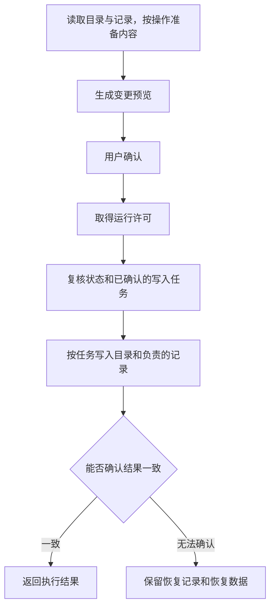

# 执行与恢复

Skill Deck 在写入前检查目录、来源记录、库应用、Agent 选择和运行许可。直接安装与维护、库内容变更和库应用分别提交各自负责的数据，失败后根据能够确认的一致性状态决定回退、重试或保留恢复数据。

受保护目录写入会修改最终 Skill 目录、Agent 专用目录或相关 lock。lock 保存来源及安装信息，提交时需要保留其他工具写入的无关记录和未知字段。库内容使用独立的内部事务；库应用链接复用受保护目录写入协议。

## Skill 变更如何执行

直接安装、维护和库应用链接使用相同的预览与执行顺序：

变更计划（`MutationPlan`）由可以独立提交的写入任务（`ExecutionUnit`）组成。每个任务处理一个 Skill 的相关目录和它负责的 lock 变化；批次中的其他 Skill 或项目可以独立完成。

业务用例决定用户意图、内容和记录变化，共享规划模块生成目录计划并校验预览凭据，运行时协调器安排任务，Environment Adapter 完成目标文件系统操作。模块边界见[系统架构](./architecture.md#skill-目录规划)，版本选择规则见[Skill 生命周期](./skill-lifecycle.md#库应用与版本选举)。

同一物理目录只生成一条计划记录。无需修改的目录使用 `Keep`：执行时只复核目录指纹和需要保护的内容摘要，不创建父目录、探针、备份或恢复记录。

## Skill 内容快照

内容快照保存本次操作使用的完整 Skill 目录，包括脚本、参考资料、隐藏文件、嵌套目录和可执行权限。

- 快照中的目录项使用相对路径，并按确定顺序记录。
- 来源中的符号链接只有在目标存在、位于来源目录内且不形成循环时才可读取；快照保存实际内容。
- 目标位置已有的链接和 Windows 重解析点作为目标条目处理，不跟随它们读取或删除其他位置。
- 临时内容由获取它的 Environment 管理，路径使用该 Environment 可以解析的格式。

直接下载另有下载体积、解包体积和条目数量上限。归档中的绝对路径、路径穿越、链接、重复路径和跨平台名称冲突会被拒绝。Well-known 来源声明内容摘要时，还需核对该摘要。

安装、复制和更新都在确认前固定并校验内容。更新准备结果按 Skill 区分可确认项与阻塞项，包含本次下载涉及的主机。执行消费已确认内容，不再进行 Git 或 HTTP 获取。

准备操作按操作 ID 和实际调用窗口登记，准备和等待确认期间不持有业务写许可。内容按原始三十分钟会话有效期逐项失效；单项内容到期时，只释放该项并记录失效，其他有效成员继续保留。关闭、取消、窗口销毁或同一窗口发起新的准备操作时，会释放原操作的相应引用；执行接管后，实际 I/O 持续持有 lease 至收尾。

会话数量上限为 32，保留额度为 512 MiB。受管理来源目录从接纳时就计入额度，与已发布 payload 共同计量。容量不足时回收可释放的缓存，仍无法接纳则拒绝新增来源或内容，已有准备内容继续受 lease 保护。来源本身超限时提示使用较小来源，所选内容无法接纳时提示减少选择；应用不保证从超大仓库中提取少量 Skill。克隆和下载过程仍使用现有并发、超时与下载限制，保留额度不表示整个过程的磁盘峰值上限。来源目录删除失败时保留占用和重试责任，确认清理完成后才扣除。

获取或创建快照失败时，最终目录尚未改变，原流程返回错误。快照过期后需要重新准备。跨 Environment 复制由来源方固定内容，再由目标方完成写入、lock 提交和恢复数据管理。

同一发现会话中的同一个 Skill 共用正在进行的内容准备任务，后续请求等待同一结果。不同 Skill 可以分别准备；不同发现会话、Environment 或 WSL Worker 代次之间保持隔离。已有快照的复用继续校验来源证据，安装预览仍根据本次目标和选择重新生成。

调用方离开后，已经启动的内容准备和校验任务继续负责 I/O 与必要清理，其他调用方仍可等待共享结果。临时占用在实际 I/O 完成后释放，内容通过清单和容量检查后才发布。准备失败时清理未发布内容，再允许重试；清理失败时保留会话的收尾责任，并拒绝复用该会话。

安装准备遇到发现会话过期或内容失效时，需要重新获取来源和 Skill 列表，再核对用户选择。目标状态变化时可以保留有效内容，重新生成预览并要求确认。

## 预览与执行

预览展示目标、覆盖内容和风险。用户确认后，应用取得写入许可并重新检查当前状态；预览凭据不能代替执行前的权限和路径校验。

以下变化会使原预览失效：

- Agent 信息、安装选择或相关规则版本变化；
- 操作位置、项目记录或运行状态变化；
- 复制来源的实际位置、物理身份、内容或来源记录变化；
- 内容快照过期；
- 目标目录、lock 或库应用记录变化。

安装、复制、移除和管理 Agent 在执行前要求预览与当前状态完整一致。更新准备期间复核所选记录、内容和已有目标，保存逐 Skill 写入计划。执行请求只提交操作 ID 和差异副本的覆盖选择，后端复核窗口归属及已确认目标。目标变化、内容失效或提交失败分别返回到受影响的 Skill，单项事务继续使用现有回退与恢复协议。

更新计划的主条目是可选执行结构，Agent 专用目录可以直接成为写入目标。主条目和附加条目统一应用差异选择；全部保留时，该 Skill 不进入事务，也不提交来源记录。明确记录的 Eve 缺失目录作为恢复动作参与同一次确认，原先缺失的通用目录和单文件备选位置继续参与过期校验。

预览过期时，界面重新取得结果并要求用户确认。失败、取消或部分完成时，工作流保留未完成项，已经成功的项目不再进入下一次重试。

普通批次按 Skill 或项目分别准备和返回结果，互不冲突的任务可以继续。单个 Scope 的库应用另有全部目标预检查要求，见[库应用事务](#库应用事务)。

## 路径安全与实际目标

前端提交 Skill、项目和操作位置等业务标识，后端重新解析实际路径。显示路径不单独构成文件访问授权。

写入前检查以下条件：

- 从最接近目标且已存在的父目录解析文件系统和访问能力；
- 拒绝文件系统根目录、用户主目录、应用配置目录和项目根目录等危险写入目标；
- 拒绝来源与目标相同、互为父子目录或复制到自身；
- 检查符号链接、目录联接和重解析点，确认路径没有越过允许范围；
- 删除或替换链接时只处理链接本身；
- 按文件系统身份和大小写规则合并同一目标；
- 确认暂存目录、备份和最终目录位于支持原子操作的同一文件系统。

Windows 使用目标文件系统的 Windows 路径规则，Linux 和 WSL 原生文件系统使用 POSIX 规则。受保护写入由能够原生管理目标文件的 Environment 完成，跨文件系统访问条件见[Environment、Skill 位置与项目管理](./environments-and-projects.md#访问-windows-和-wsl-中的项目)。

复制比较项目身份时先解析项目根链接。Windows 数据使用 Native 物理身份，WSL 自身数据使用所属发行版 Worker 的身份，WSL 挂载的 Windows 路径归一到 Native 身份。因此，项目的 Native/WSL 别名、目录链接和父子关系使用同一拒绝规则；身份无法读取时停止该项复制。这些身份只保存在本次运行状态中，恢复文档沿用既有格式。

## 原子写入与 lock 提交

提交前，系统校验计划结构、内容快照、目标冲突和状态版本，并为能够继续的任务准备 Environment 本地执行意图。

每个写入任务依次完成：

1. 复核权限、目录身份、内容摘要和 lock 证据。
2. 持久化恢复标记。
3. 在目标父目录准备临时内容，通过原子替换或原子移除修改最终目录。
4. 检查结果内容、可执行权限和链接状态。
5. 条件提交当前任务负责的 lock 记录。
6. 将恢复标记更新为可清理状态，再清理本次备份和临时内容；WSL 的结果确认顺序见下文。

目录替换、结果检查或 lock 提交前的条件校验失败时，系统先尝试还原。还原成功后返回普通失败；lock 或恢复标记已经完成原子替换，但后续阶段无法持久化或提交结果无法确认时，保留当前目录、标记和必要备份，并返回 `RecoveryRequired`。

文档提交失败时，事务内部保留失败阶段和提交是否已经生效的状态，由事务负责方决定恢复方式后再转换为业务错误。已经确认提交成功时，清理失败只产生警告，不撤销成功结果。

兼容 lock 可能被第三方 CLI 或其他工具修改。提交前重新读取最新文档，只改写本次负责的记录，保留其他记录、未知字段和不冲突的外部修改。负责的记录已经变化时返回过期或冲突。

名称键迁移使用同一项 `MoveAndReplace` 检查旧键与新键，再一并移除和写入；任一快照变化都不提交。一个任务成功后，后续任务使用新的 lock 证据。路径和字段兼容规则见[skills CLI 参考与兼容](./skills-cli-reference.md)。

项目记录和最近选择的 Agent 记录采用单文档写入，不使用 Skill 目录恢复事务。WSL 主进程传入读取时的修订号，Worker 有界重读并核对目标，只接受缺失或普通文件，再通过同目录临时文件原子替换。状态变化返回过期，断连或超时后不自动重放。

## 库内容事务

库元数据文档（catalog）、成员目录和来源记录只由当前应用实例写入。运行时按 Environment 串行化操作，WSL Worker 再通过发行版内的库写入入口串行处理 I/O。单写者边界见 [ADR-0010](./adr/0010-use-single-writer-library-persistence.md)。

### 成员与整库提交

| 操作 | 事务边界 |
|---|---|
| 新增、同名更新、重新激活成员 | 内容、来源记录、摘要和本地提交时间一起提交，失败时保留完整旧状态或完整新状态 |
| 退役成员 | 条件更新库元数据，将成员移入退役集合，暂时保留原目录 |
| 删除整个库 | 先将完整库目录原子移入同一管理根目录的事务备份，再条件提交删除后的库元数据 |

新增或退役成员前，应用用拟提交的库元数据预览全部已知 Scope。凭据绑定成员动作、应用记录盘点结果和各 Scope 计划；在写许可内重新生成预览，任一证据变化都会阻止提交。

应用层在最新库元数据上合并本次记录，保留其他成员和未知字段。WSL Worker 在同一个不可重放的请求中复核目录、内容、文档修订和内容句柄，再完成目录替换、元数据提交、事务标记与备份管理。

### 内部恢复与清理

库事务的恢复在后续访问时进行：

| 已确认状态 | 恢复方式 |
|---|---|
| 库元数据尚未提交 | 恢复原目录和备份 |
| 已持久化 `catalogCommitted` 终态 | 保留已提交结果，仅清理本次事务的临时项、备份和标记 |
| 无法解析标记或确认一致性 | 保留证据，返回“库内部恢复未完成”，阻止该 Environment 后续库读写 |

已经提交的事务以持久化终态为准，不根据目标之后是否存在重新判断。提交后的清理失败保留完整事务证据，后续访问继续尝试清理，其他已经确认一致的库仍可读写。

Worker 在库读写前处理未完成的内部事务。Environment 不可用、权限变化、标记损坏或备份缺失导致无法恢复时，下一次访问或重新连接后再次检查。库内部恢复不创建用户可见的目录恢复记录。

退役内容清理需要完整枚举应用记录，确认已完成同步状态、未完成操作和恢复数据均不再引用该成员。清理前复核退役标识、目录身份、内容摘要和库元数据修订；任一变化都会停止清理并保留现状。

## 库应用事务

库应用记录区分已经生效的配置、最近完成同步的状态（checkpoint）和已经确认但尚未完成的操作（pending）。记录保存在对应 Environment 中，Scope 由 `applications/global.json` 或 `applications/projects/<projectId>.json` 确定，不重复保存运行时 Environment 身份。

### 待处理操作与规划

配置调整、成员同步和主动重新应用可以形成待处理操作。普通检查失败只报告问题，不创建新的写入任务；已有任务暂时无法验证时保留原业务原因，并标为 `unverified`。

写目录前先持久化已经确认的目标和待处理成员。连续操作合并受影响的成员集合，保留中间已经发生的变化；包含主动重新应用时，处理完整应用范围。

自动维护和手动重试先比较应用记录与最新库元数据。没有待办且 checkpoint 已一致时直接结束；需要继续处理时，才读取 Agent、目录和恢复状态，重新规划剩余操作。

### 写入前检查与任务回退

单个 Scope 在写入前检查全部必需目标。Native Adapter 和 WSL Worker 对需要改动的目录执行可逆的创建、重命名和删除探测；任一已知目标不可访问、不安全或冲突时，该 Scope 不写入 Skill 目录，也不提交新的生效配置。

探测通过后，仍在每个 Skill 事务提交前复核身份和内容。执行以单个 Skill 为完整任务，失败时一起还原该 Skill 的通用目录和本次涉及的 Agent 专用目录，先前成功的其他 Skill 保持新状态。

WSL 探测超时后先发送取消信号，等待当前文件操作结束后返回终态。主进程未能等到终态时关闭 Worker 会话，并等待对应 `wsl.exe` 子进程退出。

### 恢复与解除应用

目录事务需要人工恢复时，恢复存储保留事务与 Scope 的关联，应用摘要据此生成 `recoveryRequired`，pending 不重复保存该状态。

一个 Scope 失败不回滚其他 Scope。重新处理时复核已经完成的目录，只执行仍需变化的部分；业务上的同步范围见[Skill 生命周期](./skill-lifecycle.md#成员同步与继续处理)。

移除项目记录前，应用先解除库应用并完成未决操作。空应用状态和空 checkpoint 提交后，再按原文档快照条件删除应用记录；删除结果未明确成功时，项目记录继续保留。

## 批量结果

每个写入任务返回以下状态之一：

| 状态 | 含义 |
|---|---|
| `Succeeded` | 本次负责的目录和记录已经提交，可能附带清理警告 |
| `Failed` | 当前任务未完成，但已经确认结果一致，可以继续操作 |
| `Skipped` | 明确的业务条件使当前任务无需执行 |
| `Cancelled` | 取消已生效，当前任务的写入已经停止 |
| `NotRun` | 在计划或写入前检查阶段停止，最终目录尚未修改 |
| `RecoveryRequired` | 无法确认目录与相关记录一致，需要检查文件 |

错误和警告使用稳定代码和必要参数，前端据此显示对象、原因、重试或恢复入口。内部校验信息保留在本机诊断中。

## 应用内写操作互斥与取消

持久化写入口在产生副作用前取得运行许可，避免冲突操作同时执行。安装会话、配置、凭据、项目和应用更新的许可由统一协调器管理，主窗口与向导的可用操作见[产品行为与交互](./product.md#安装会话与写操作)。

取消在能够安全停止的位置生效：

| 当前阶段 | 取消后的处理 |
|---|---|
| 写入前检查或任务尚未开始 | 停止后续工作，返回取消或未运行 |
| 可以中止的准备或写入步骤 | 停止当前任务并完成必要还原和清理 |
| 不可中断的原子操作 | 先完成当前步骤，再响应取消 |
| WSL 事务已发送或已接受 | 发送取消消息并等待 Worker 终态，按下文规则判断结果与恢复需求 |

已经完成的任务保留实际结果。发出取消请求不代表写入已经结束，界面需要等待最终结果后才能关闭、退出、重启或开始冲突操作。

## 在应用所在系统或 WSL 中写入

各平台使用相同的预览和恢复原则，文件操作遵循目标文件系统语义：

| 执行位置 | 负责的文件系统能力 |
|---|---|
| Windows | 目录联接、重解析点、大小写、文件占用和 UNC 路径 |
| macOS、Linux | POSIX 符号链接、权限、可执行位和文件系统身份 |
| WSL | 发行版中的 POSIX 路径、目录操作、lock 和恢复数据 |

WSL 事务开始获取 Worker 和等待重连前就确定绝对截止时间。准备、传输、Worker 执行、终态等待和取消收尾共用这一时间预算。

Worker 持久化恢复标记后发送 `MutationAccepted`，再修改最终目录或 lock。主进程发出完整写入请求后，就按“可能已经执行”处理；即使没有收到接受消息，断连或超时也根据预先确定的恢复标识检查结果，不自动重放事务。

用户取消时，主进程发送取消消息并等待最终状态。超过截止时间仍无法取得结果时关闭会话；写入请求已经完整发出时，按预先确定的恢复标识检查结果，不能仅凭取消或超时判断目录未变化。

成功响应携带恢复标记摘要，标记保留为 `CleanupOnly`。主进程确认收到成功结果后发送确认消息，Worker 只清理摘要匹配的标记与备份。主进程继续协调后续任务及其 lock 证据。

跨 Windows 与 WSL 文件系统的写入限制、切换和持久化数据保留规则见[Environment、Skill 位置与项目管理](./environments-and-projects.md)。

## 恢复记录与恢复数据

目录任务进入受保护阶段前保存恢复标记，记录目标、备份和执行阶段。正常完成或成功还原后清理标记；无法确认一致时，保留标记和必要备份，并形成用户可见的恢复记录。

暂存目录只保存未提交的新内容。可控失败在返回前清理暂存内容；进程突然终止或还原失败时，后续清理根据有效标记中的目标和备份身份定位同一事务的暂存目录。缺少有效标记的同名前缀目录不会自动删除。

来源获取、生成预览、普通配置写入和写入前检查失败时，原工作流直接反馈，不创建目录恢复记录。应用启动时读取 Native 恢复数据，重新连接 WSL 后读取对应发行版的数据。

应用继续识别旧版本来源修复操作留下的恢复记录，允许用户查看和清理对应数据；当前版本不再创建新的来源修复操作。

| 检查结果 | 含义 |
|---|---|
| 需要处理（`NeedsAttention`） | 目录与相关 lock 不一致，或仍无法确认 |
| 可以清理（`ConsistentCanCleanup`） | 已经确认一致，可以删除本次标记和备份 |
| 位置不可用（`EnvironmentUnavailable`） | 暂时无法访问，恢复可用后重新检查 |
| 记录损坏（`Invalid`） | 无法安全解析，只提供诊断和受控目录入口 |

当前写入 v2 恢复格式，并继续读取 v1。现有格式仍保存 Environment 和资源位置；旧记录缺少 Skill 或项目信息时使用通用说明。未来版本、损坏 JSON 或不安全路径均按记录损坏处理，不使用其中未经确认的路径，只允许打开受管理的诊断目录。

有效记录可以打开当前文件与备份所在的共同父目录。用户处理后选择完成，系统再次核对目录、lock 和记录；状态一致且记录未变化时，才删除本次标记和备份，保留当前 Skill 文件。

恢复入口不替用户选择保留哪份内容，也不自动继续中断的安装、更新或复制。原操作从对应工作流重新发起，用户入口见[产品行为与交互](./product.md#处理需要检查的写入结果)。
