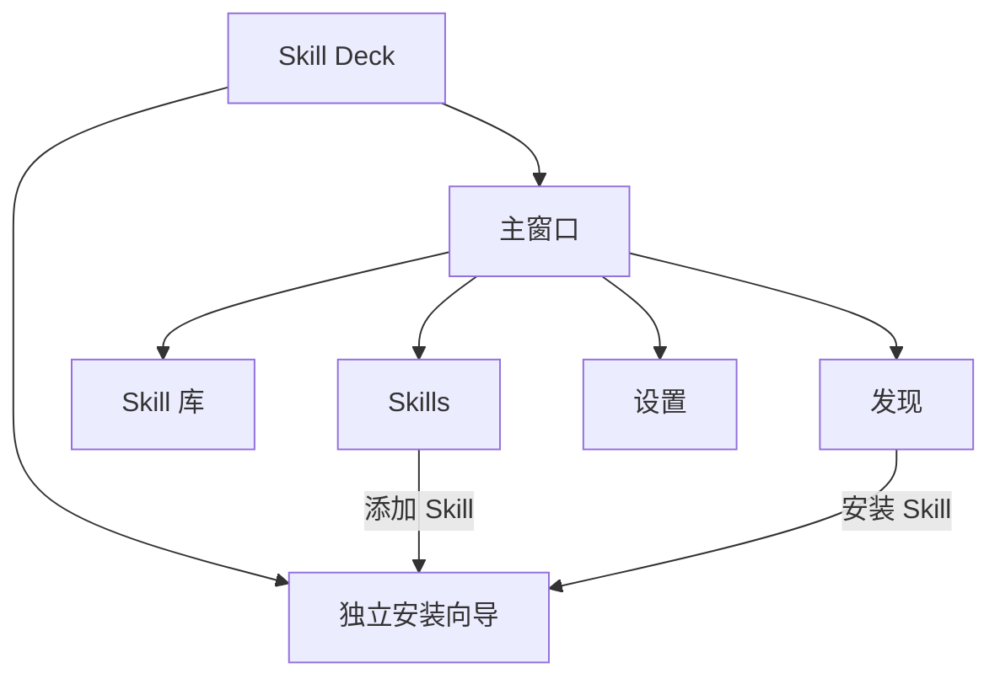
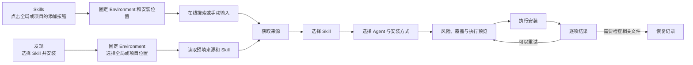

# 产品行为与交互

## 产品定位

Skill Deck 是管理 AI Agent 所用 Skill 的本地桌面应用。用户可以在 Windows、macOS 和 Linux 上浏览、安装、阅读、更新、复制和移除 Skill，也可以管理 Skill 与 Agent 的关联关系。Windows 用户还可以管理已安装 WSL 发行版中的 Skill。

[skills CLI](https://github.com/vercel-labs/skills) 是由 `vercel-labs/skills` 项目独立维护的第三方 Skill 管理工具。Skill Deck 自行实现桌面端功能，运行时不调用该 CLI；两个工具可以分别管理同一份兼容 Skill 数据。用户可以单独使用 Skill Deck，也可以根据需要搭配使用两个工具。具体兼容范围和参考原则见[skills CLI 参考与兼容](./skills-cli-reference.md)。

## 用户看到的核心概念

- **Environment** 区分 Skill、项目和文件操作的数据归属。默认使用桌面应用所在的操作系统；Windows 用户还可以管理 WSL 发行版中的内容。
- **AI Agent** 是独立于 Skill Deck 安装和运行的 AI 智能体，能够根据用户目标决定行动步骤、调用工具，并根据执行结果调整后续行动。
- **Agent Skill（技能）** 汇集了处理特定任务所需的知识和工作方法，Agent 在相关任务中按需加载，也可以使用其中的脚本、模板和参考资料。
- **Scope** 是当前 Environment 中的全局或项目管理范围。全局 Skill 不属于具体项目，项目 Skill 属于对应项目；每个范围包含通用 Skill 目录和各 Agent 的专用目录。
- **直接安装 Skill** 属于某个 Scope，在界面中称为“已安装 Skill”。**Skill 库** 则独立维护一组 Skill，用户可以将多个库应用到全局或项目范围。
- **Skill 来源** 提供 Skill 内容。一个来源可以包含一个或多个可安装 Skill。

Agent 能否读取某个 Skill，取决于它的读取规则和实际目录内容。Skill Deck 根据配置推测 Agent 是否已经安装，并分开展示检测结果和 Skill 关联关系。

统一术语见 [`CONTEXT.md`](../CONTEXT.md)。Agent 规则见[Agent 模型](./agent-model.md)，位置和项目规则见[Environment、Skill 位置与项目管理](./environments-and-projects.md)，直接安装与库应用的关系见[Skill 生命周期](./skill-lifecycle.md)。

## 应用结构

主窗口提供 `Skills`、`Skill 库`、`发现` 和 `设置` 四个一级页面，并集中展示安装流程、写操作状态和恢复入口。

主窗口正常退出时保存普通状态的尺寸、位置和最大化状态，再次打开时恢复。原位置不在可用显示器上时由系统重新放置窗口。首次启动或记录不可用时使用默认窗口，最小化状态不随启动恢复。窗口恢复不改变未保存草稿与进行中写操作的关闭保护。

标题栏所在内容区域小于 800px 时，只保留当前页面的名称，其余导航项显示图标。达到 800px 后，只有实际剩余空间能容纳全部页名、且导航两侧各保留至少 24px 拖动空白时，才展开全部名称；从收起状态恢复时额外预留少量空间，避免临界宽度下反复切换。当前页面名称始终保留，导航项在文字显隐时保持等高。安装状态也可以收起为图标。导航、Environment 切换、恢复入口和窗口操作保持可用，macOS 的原生窗口按钮使用独立的预留区域。

一级导航与标题栏共用背景，当前页面通过较深文字和短指示线标识；悬停底色与键盘焦点轮廓分别表达指向和聚焦。导航上下留出空隙，与内容区以细分隔线区分。导航项之间及两侧的空白区域可以拖动窗口，交互控件各自响应点击。

`Skills`、`Skill 库`、`发现` 以及设置中的 Agents 和 Projects 共用当前 Environment。通用设置、Git 和关于页不依赖该选择。

安装向导在独立窗口中完成，可以从 `Skills` 页的全局或项目区域发起，也可以从 `发现` 页的 Skill 详情发起。打开向导不会改变主窗口当前显示的内容。

## 界面文案

中文操作标题、说明和反馈语句引用具体 Skill 名称时，统一使用直角引号 `「」`，以区分操作文字与名称。该规则适用于直接安装 Skill 和库成员的安装、更新、复制、移除、管理 Agent 及恢复提示；项目名称嵌入句子时采用相同规则。

| 场景 | 展示示例 |
|---|---|
| 删除确认标题 | 删除「ask-matt」 · 全局 |
| 复制到项目标题 | 复制「ask-matt」到其他项目 |
| 管理 Agent 标题 | 管理「ask-matt」的关联 Agent |
| 更新进度提示 | 正在更新「ask-matt」 |
| 项目更新标题 | 更新「skill-deck」的 Skill |
| 独立名称或 Skill 分组标题 | ask-matt |
| 未引用具体名称的批量标题 | 更新全局 Skill |

独立展示的名称、列表项和分组标题保持原名。名称作为字段值展示时也保持原名，例如 `项目：skill-deck`。

引号写在中文国际化模板中，例如 `删除「{{name}}」`；名称数据保持原样。英文及其他语言按各自语言习惯处理，组件和共享名称格式化逻辑不统一添加中文引号。

## 选择要管理的 Skill

### 在 Windows 和 WSL 之间切换

- Windows 用户在通用设置中启用 WSL 支持并发现可用发行版后，主窗口持续显示 Environment 切换入口。用户可以选择 Windows 或以 `WSL · 发行版名称` 展示的发行版；支持关闭或没有可用发行版时隐藏入口。macOS 和 Linux 不提供这项设置和入口。
- 选择 WSL Environment 时，界面先显示连接状态；连接成功后展示该 Environment 的全局 Skill，再加载已添加项目。连接或项目加载失败时，界面继续显示已经成功加载的内容，并提供与当前阶段对应的重试操作。
- 关闭 WSL 支持时，确认窗口持续展示切回 Windows、等待现有操作结束和停止使用 WSL 的进度。某个阶段失败时，界面显示已经完成的步骤并允许重试；已经保存的 WSL 项目和设置继续保留。

### 浏览全局 Skill 和已添加项目

- `Skills` 显示当前 Environment 中的全局 Skill 和已添加项目。
- 切换到其他 Environment 成功后，应用立即展示目标 Environment 的全局 Skill，再独立加载已添加项目。在首次成功加载完整项目列表前，添加项目入口保持禁用；首次加载失败时，项目区域显示错误和重试操作。
- 项目列表成功加载后，后台刷新期间继续显示现有项目并允许添加项目。后台刷新失败时，界面保留现有列表，同时说明本次错误并允许用户重试。
- 用户可以添加项目、移除项目或打开项目配置。已添加项目按 Environment 隔离。

Environment 切换、全局 Skill 和已添加项目的完整规则见[Environment、Skill 位置与项目管理](./environments-and-projects.md)。

## 浏览已安装 Skill

`Skills` 由 Skill 位置导航、Skill 列表和详情区组成。

打开详情后，尚未手动调整的 Skill 列表默认占列表与详情区域的 30%，宽度保持在 240～320px，详情使用剩余空间。自动布局按当前侧栏宽度、至少 240px 列表和约 480px 详情阅读宽度判断能否显示三栏；空间不足时收起位置导航，并显示当前范围或库名及展开入口。导航重新展开时预留少量空间，避免临界宽度下反复切换。

用户可以拖动列表与详情之间的分隔条调整宽度。Skills 和 Skill 库分别记住用户选择的列表宽度；窗口临时收窄时保留偏好，恢复空间后重新使用。手动分配允许详情收窄至 360px，列表仍至少保留 240px。窗口自动缩放产生的宽度不保存为手动偏好。

常驻的项目和库侧栏默认宽度为 208px，用户可以通过分隔条拖动或键盘调整至 192～320px。打开详情时，可调整上限随窗口空间收紧，为列表和详情保留可用区域。两页分别记忆侧栏宽度，与 Skill 列表的宽度偏好相互独立；窄窗口中的临时抽屉固定为 208px，窗口放大后恢复常驻侧栏偏好。

详情面板的开关独立于当前选中的 Skill。切换 Scope 或库时清空旧对象及详情内容，保留面板、列表宽度和侧栏折叠状态；没有选中项时显示空态，用户关闭详情后恢复单列表。抽屉入口与当前 Scope 位于 Skills 列表侧的顶部工具区；库页面将抽屉入口并入已有库标题工具栏，仅显示一份库标题。

展开临时导航后，键盘焦点进入当前选中项。按 Esc 或点击导航外部可以收起导航并回到展开入口，详情保持打开；焦点移到其他页面区域时导航收起，进入导航中的菜单或确认弹窗时保留导航。窗口变化使聚焦的导航入口隐藏时，焦点转到对应的可见入口。侧栏内容保持挂载，保留自身的滚动位置。

Skills 和库成员的紧凑列表区分当前选择与键盘焦点。上下方向键按可见顺序移动焦点，Home、End 定位首项和末项，Enter 或 Space 选择聚焦对象并打开详情。移动焦点时，右侧详情继续显示原对象。紧凑对象集合保留一个主要 Tab 入口，重新进入时优先当前选中项，其次是仍可见的最近焦点；分组命令、筛选和详情控件各自可达。

从卡片名称打开详情后，焦点衔接到同一对象的紧凑行；关闭详情后回到对应卡片的名称。对象已不在可见结果中时，优先返回原位置的下一项或上一项，没有可见对象时返回搜索框；空列表未提供搜索时，返回可用操作入口。后台刷新和筛选保留仍有效的焦点，正在输入和弹窗中的焦点继续由当前控件持有。焦点记录按 Environment、Scope 或库区分，全局和项目中的同名 Skill 分别处理。

焦点位于两页的 Skill 列表内容区时，Ctrl+F（macOS 为 Command+F）定位并选中搜索文字。详情、位置导航和弹窗保持自身的按键归属。搜索有内容时，Esc 先清空关键词并保留输入焦点；空搜索才继续执行工作区的关闭行为。中文输入法组合期间，按键优先用于完成输入。

- 列表维护当前 Scope 的直接安装版本，包括仅存在于 Agent 专用目录的 Skill。同名库版本由库页面维护；两者并存时，直接版本继续显示，详情提供当前使用的同名库成员入口。
- 列表以已安装 Skill 为主体，并提供关键词搜索、Agent 筛选、刷新和更新检查。筛选器默认显示“全部 Agents”；选择具体 Agent 后，列表展示当前 Skill 位置中可供该 Agent 使用的 Skill。关键词与 Agent 条件同时生效；用户通过搜索框清空关键词，通过“全部 Agents”恢复 Agent 筛选。
- 筛选器列出当前 Skill 位置中已经检测到的 Agent。Agent 当前没有关联 Skill 时仍可选择，列表显示对应空状态。
- 全局 Skill 与当前项目 Skill 使用独立区域，并各自提供新增入口。某个区域没有筛选结果时，该区域在 Skill 列表位置显示紧凑空状态，另一个区域继续展示自己的结果。
- 切换全局或项目位置时，Skill 列表回到顶部，位置侧栏保持原有滚动位置。如果目标位置仍支持当前 Agent 筛选，筛选条件继续生效；确认目标位置不支持该 Agent 后，界面清除筛选条件。加载期间不改变用户当前选择。
- 项目 Skill 读取失败时，该区域显示不可用状态，并提供检查项目位置或切换 Environment 的下一步。
- 单个 Agent 目录或 Skill 内容读取失败时，区域保留其他已经确认的 Skill 卡片，并显示本次结果不完整及重试入口。问题数量超过界面明细上限时显示汇总与省略数量；需要完整目标事实的维护操作继续由后端重新核对。
- 全局与项目区域在滚动时持续显示标题、数量、更新摘要和主要操作。空间不足时压缩次要信息，用户仍可查看完整状态。
- Skill 卡片左侧保留位置图标，名称、所属来源插件（plugin）、主要更新状态与右侧操作位于标题行；插件名只说明归属，不提供点击操作。简介、来源、提醒和已检测到的关联 Agent 与名称共用一条左侧对齐线。库成员卡片沿用相同的对齐规则。
- 卡片底部的来源、分支与时间组成元信息行，关联 Agent 在下方独立成行，并与简介、来源左对齐。Agent 使用紧凑、低饱和度的绿色标签，与来源链接和更新状态区分；保留完整名称，数量较多时在自身区域内换行。提醒保持独立，卡片高度随实际内容增长。名称、来源和图标命令支持悬停及键盘聚焦提示，行内命令的提示包含对象名称。
- 紧凑列表使用稳定的名称与来源两行，沿用完整卡片的来源判定与本地化文案；本地来源显示“本地 Skill”，来源信息不完整时显示对应提示。紧凑行整体选择对象，完整来源可以通过悬停或聚焦查看。
- 来源名称只在能够打开对应地址时显示为链接，并通过系统默认应用打开。更新时间采用渐进格式：今天显示时间，当年显示月日，跨年显示年份；悬停或聚焦后可以查看完整本地日期时间。
- 没有来源记录的有效 Skill 和来源类型为本地目录的 Skill，都在卡片与详情的来源位置常驻显示中性文字“本地 Skill”，不附加更新能力说明。它们不参与更新检测，也不计入来源异常、检查异常或待维护数量。
- 直接安装和库成员的卡片、详情使用一致的来源与更新表达。常态标题标签只突出“新版本可用”，检查失败不撤销同一安装基线下已经确认的更新结论。没有标签不表示已确认最新；手动检查成功且没有更新时短暂提示“已是最新”。
- 普通网络错误或超时不作为常驻标题标签或详情诊断块。用户主动检查未完成时按实际原因反馈：网络问题可以提示重试，认证问题提示检查访问权限，未知或混合原因使用中性说明；后台检查不弹出干扰提示。需要处理的来源或认证问题保留简短提醒，具体原因按需查看，现有处理操作继续直接展示。
- 卡片用一个注意图标和短文案集中展示需要处理的来源问题和重复安装关系。已保存的来源记录存在但字段不完整或无法解析时，只显示“来源信息不完整”；来源中的原 Skill 已不存在时显示“来源中已找不到此 Skill”。全局和当前项目都存在同名 Skill 时显示“全局和项目中重复安装”；Agent 可以读取通用目录、但其专用目录仍保留安装项时显示“通用目录和 Agent 专用目录中均已安装”。这两项只说明实际安装关系，不推断内容是否同步。
- Skill 卡片和详情只列出能够读取当前直接安装版本、且已检测到的关联 Agent，并允许标签自然换行。读取同名库版本的 Agent 归入对应库的使用关系；完整关联规则见[Agent 模型](./agent-model.md#关联-agent)。
- 选中 Skill 后，界面切换为列表与详情分栏。详情先按当前目标、来源、本地安装、使用关系、安全与维护分组展示信息，再展示 `SKILL.md` 内容。列表没有单独的详情按钮，用户可以点击 Skill 名称或卡片进入详情。
- 详情头部显示名称、更新标签和现有操作，不重复显示项目及 Environment 信息行。更新和删除确认在标题中标明全局或项目范围，操作仍绑定打开时的 Environment。项目内的安装位置默认显示相对于项目根目录的路径，全局安装位置优先以当前 Environment 的用户主目录缩写为 `~`。不能缩写的位置保留完整路径，业务处理结果由对应清单说明。悬停或键盘聚焦可以查看完整地址；详情中的复制图标复制完整地址。项目选择列表继续显示完整项目根路径。
- 已安装 Skill 与库成员详情采用一致的字段层级，来源、时间和路径等属性均保留可见标签，标签在上、值在下。完整字段根据内容和详情宽度并排或换行，两项维护时间保持成组；安装路径在可用宽度充足时与短属性并排，窄面板中使用整行。关联 Agent 位于属性区底部，沿用列表的标签样式并完整换行；同名库版本入口位于 Agent 之前。库成员保留自己的来源、更新时间、插件名和分支，长值可以换行。简介先显示两行，超出时可展开和收起。来源和图标操作支持悬停与键盘聚焦提示，截断来源的提示包含完整内容；对象信息与文档正文使用轻分隔线区分。更新检查统一从标题栏进入，检查未完成时可在同一入口重试，凭据和来源问题保留对应处理入口。
- 两类详情固定显示名称与现有维护命令，简介、属性、状态说明和文档位于同一个滚动区。名称与简介保持视觉关联，属性通过间距形成独立分组。维护命令直接显示，关闭详情与维护操作分组；名称单行显示，截断时可悬停或键盘聚焦查看全文，空间不足时命令组移到第二行。正文保留作者提供的标题和段落，以文档内部层级呈现。更换对象或其所属 Environment、Scope、库时，内容从顶部开始；重复选择当前对象、检查状态变化和取消维护弹窗保留阅读位置，弹窗关闭后焦点回到发起命令。正文重新读取期间保留已有内容，失败时标明仍显示上次读取结果并提供重试；库成员内容版本变化时重新读取当前成员。读取请求继续按对象与请求标识隔离，旧响应不会覆盖新选择。
- 两类管理详情的正文使用一致的段落、列表、引用、代码和表格样式。行内代码和代码块使用独立的正文浅底色。表格沿用 GitHub Markdown 的配色与边框规则：表头与首个正文行使用默认底色，正文偶数行使用浅底色，每个单元格有完整细边框，表头加粗；字号保持应用的正文密度。代码块保留空格、缩进与换行，复制入口复制解析后的代码文本，成功时原位反馈，失败时允许重试。单行命令与常驻复制入口同行；多行代码使用完整宽度，悬停或键盘聚焦时在右上角显示复制入口，触屏设备常驻显示。复制入口不占用代码行，横向滚动时位置固定，代码末尾保留滚动余量。短表按内容占宽，宽表与长代码在各自区域横向滚动，只有溢出区域加入键盘滚动顺序。表格与代码纵向随正文展开，详情整体保持原有宽度和阅读位置。
- 管理详情中的 HTTP/HTTPS 正文链接通过系统默认浏览器打开，应用保留当前对象和阅读位置；当前文档的章节链接只滚动该详情，并将键盘焦点衔接到目标。找不到章节或打开失败时给出明确提示。相对文件、绝对本地路径和其他当前未支持的引用保留原标签及完整目标，直接提供复制地址入口。HTTPS 图片保持比例，小图沿用原始尺寸；加载失败时在原位置显示简洁说明并允许单图重试。未支持的图片地址提供复制入口，带链接图片的导航与图片维护操作分别响应。图片状态随对象和资源地址隔离，重试成功后保留阅读上下文。
- 可用操作包括检查更新、执行更新、管理 Agent、复制到项目和移除。卡片尾部直接显示当前可用操作，用户可以通过一次点击发起对应操作；需要确认的操作继续使用确认界面。
- Skill 内容读取失败时，列表和详情中的其他信息继续显示，内容区域允许用户重试。
- 写操作进行时，界面禁用与其冲突的操作，一次只执行一个写操作。

## 组织和应用 Skill 库

### 浏览和维护库

`Skill 库` 是独立于全局 Skill 和项目 Skill 的一级页面。用户可以在当前 Environment 中创建多个库，添加、更新和移除成员，再将库应用到全局或项目范围。

页面由库列表和当前库的工作区组成。库列表每行显示库名和应用状态，并提供重命名和删除入口：

| 应用状态 | 展示内容 |
|---|---|
| 已有生效位置 | 已应用的位置数量 |
| 只被未完成的调整引用 | 应用调整未完成 |
| 没有应用关系 | 未应用 |

当前库的名称、应用状态、成员数量、更新概况和主要操作固定显示在工作区顶部。成员数量表示全部成员，搜索命中数量单独显示在搜索区域。窄窗口使用双行顶部布局，状态和操作保持可见。

应用位置较少且空间充足时直接显示位置名称，否则显示数量，并提供可聚焦的展开入口。展开后可以查看全局或项目位置，以及未完成的调整；项目名称采用统一展示规则，完整路径作为次要信息。未应用的库会说明可以在 `Skills` 页中应用。

成员卡片显示名称、简介、来源和 Skill Deck 最近一次写入该成员内容的时间，并提供移除操作。有可用更新或可重试的更新时，卡片显示更新操作。用户可以点击卡片或名称阅读 `SKILL.md`。

整库检查区分有更新、没有更新、无法检查和来源中已不存在，本地和导入成员不计为检查失败。重试开始清除旧的操作错误，保留仍然有效的成功比较；本次失败显示新原因，成功后清除操作错误。逐来源失败继续按本次结果展示。版本信息不完整时，保留现有内容并提示无法检查更新。批量更新按当前筛选结果显示数量并提交所选成员；失败和未执行成员保留具体结果及可用的重试入口。

### 添加和移除成员

添加成员时，主窗口打开模态流程，固定当前 Environment、库和已有成员。流程依次完成来源读取、Skill 选择和添加确认，期间背景页面和 Environment 切换不可操作；写入开始后不能关闭流程或退出应用。

来源输入与[安装向导](#从-skills-页面添加)使用相同能力。命令中的 Skill 选择用于预选成员，Agent 参数不改变库成员；界面会说明添加完成后可以从 `Skills` 页应用该库。当前库已有的同名 Skill 持续显示为不可选项，也不计入可选数量。

确认页列出本次添加的成员和已应用位置的影响，包括新增、切换、回退、移除、保持不变以及暂时无法确认。长路径通过可聚焦提示展示完整内容。下载跨主机跳转时，用户需要确认最终主机；预览过期时，在当前页面刷新影响并再次确认。

添加弹窗的底部按钮统一靠右排列：取消使用弱化样式，上一步使用无图标的次级按钮，中间步骤使用“下一步”，最终写入使用“确认添加”。写入期间显示禁用的“添加中…”按钮；全部添加成功后显示“完成”，部分失败时保留关闭和重试失败项的入口。

确认页将待添加数量作为清单标题，同一行按需显示同步位置数量；已确认同步位置为零时隐藏该信息。有同步位置时，用户可以展开查看具体位置及影响；盘点不完整和无法验证的风险直接显示。成员行中的名称按内容占宽，长名称限制最大宽度，路径紧随其后并使用剩余空间。Windows 盘符和 UNC 路径的内部前缀只在展示时转换，正文与完整路径提示保持一致，实际写入路径保持原样。

已经应用的库仍可添加或移除成员。用户在现有流程的最终按钮确认一次，应用随后同步受影响的位置。结果分别展示已同步、待处理、未验证、需要恢复和已取消的位置数量，并单独说明保留内容的清理结果或结果读取失败。

添加结果按 Skill 展示，部分失败时只重试失败项，并保留先前成功的结果。成员同步未完成时，页面提供按库重试的入口。

库页面的成员同步提示只展示当前库需要处理的结果；没有结果内容或全部处理成功时，列表上方不保留提示区域。操作结果按 Environment 和库分别保存，切换库后不会显示其他库的结果或向其他库重试。重新进入页面时，已记录的未完成结果继续保留；没有本次运行的操作结果时，页面根据当前库读取到的未完成应用关系提供继续处理入口。重试完成后重新读取库详情，读取失败时保留已完成结果并显示错误。

### 管理应用位置

`Skills` 页的全局和项目区域分别提供“管理 Skill 库”入口。用户可以选择多个库、调整优先顺序，并为支持库应用的 Agent 选择专用目录。空库也可以应用，之后加入的成员会继续同步到这些位置。

当前应用的库显示在区域标题下方、直接安装 Skill 列表上方。图标、库名和成员数量说明库的身份，排列顺序说明优先级。库摘要只展示应用状态，维护内容通过一级“Skill 库”页面完成。

库摘要展示当前区域的全部应用库。普通列表空间不足时允许换行，紧凑列表按库逐行展示；未应用任何库时隐藏摘要，未完成的应用调整继续显示。关键词搜索和 Agent 筛选只影响直接安装 Skill 列表。

管理弹窗在宽窗口中并列展示库选择和关联 Agent，在窄窗口中上下排列。两部分独立滚动，标题和操作区保持固定。已应用库与未应用库分开展示，前者的顺序表示优先级；Agent 复用统一的名称、分组和检测状态。

已保存但当前不再可关联的 Agent 单独显示原因并默认保留，用户明确取消后才解除关联。修改配置后可以直接保存；配置没有变化且已应用库时，可以主动重新应用，修复缺失或失效的受管理链接。保存和重新应用均在当前弹窗中完成，不增加独立确认页。

操作成功后刷新 `Skills` 页并关闭弹窗。状态过期、目标冲突或临时失败时，弹窗保留当前选择和处理入口。单个位置未完成时持续显示继续入口；已完成的其他位置保留结果。写入前关闭弹窗会放弃未保存修改，写入期间不能关闭。

同名 Skill 可能在不同 Agent 的目录中使用不同版本。直接安装版本只在已关联的目录中优先；取消直接关联或移除直接安装 Skill 后，相应目录可能恢复库版本。完整规则见[库应用与版本选举](./skill-lifecycle.md#库应用与版本选举)。

### 删除库与读取失败

删除前需要解除全部应用关系，并完成仍引用该库的未决调整。确认期间始终以用户点击的库为目标。

删除未选中的库时继续显示当前库；删除选中库时优先选择原位置的下一项，没有下一项时选择上一项。删除最后一个库后显示空状态。

删除失败时，确认界面保留目标并说明原因。删除成功后若详情读取失败，只提供重新读取入口，不再次执行删除。

应用关系盘点不完整时，页面保留已经确认的库和位置并显示问题提示，整库删除和退役内容清理暂时不可用。库列表读取失败时显示具体原因和重试入口。

## 添加与安装 Skill

用户可以从 `Skills` 页的全局或项目区域直接添加 Skill，也可以先在 `发现` 页浏览 Skill 再发起安装。两个入口打开同一个独立安装向导，但带入向导的初始信息不同。

### 从 Skills 页面添加

- 全局 Skill 与当前项目 Skill 区域分别提供添加按钮。用户点击哪个区域的按钮，向导就固定使用打开时的 Environment 和对应的全局或项目位置，并从来源步骤开始。
- 来源步骤提供“在线搜索”和“手动输入”两种方式。在线搜索用于按名称查找 Skill；选择搜索结果后，向导立即读取其来源并预选该 Skill。手动输入支持 GitHub、Git、本地路径、Well-known 地址、原始 `SKILL.md` 与 ZIP、tar、tar.gz 归档地址，以及受支持的 `skills add` 命令。
- 已识别的 Well-known 来源中，页面路径与来源范围不匹配时，向导提示用户检查输入，不自动改用站点根目录。来源类型和解析规则见[Skill 生命周期](./skill-lifecycle.md#well-known-与直接下载)。
- 一个来源包含多个 Skill 时，向导默认列出公开 Skill。通配选择包含全部公开 Skill；只指定具体名称时，还可以显示同名的内部 Skill（`internal`）。用户可以保留预选项，也可以调整选择，完整可见性规则见[目录发现与选择](./skill-lifecycle.md#目录发现与选择)。
- `skills.sh/p/...` Skill 集合（Pack）链接没有指定具体 Skill 时，向导初始选中其中的全部 Skill。用户仍会经过 Skill 选择页和确认页，可以搜索、取消单项、全选或清空；Pack 不会自动开始安装。链接或 `skills add` 命令已经指定具体 Skill 时，只预选明确指定的项目。

### 从发现页安装

`发现` 页用于浏览远端可安装 Skill。

列表支持单一 Tab 入口，以及方向键、Home 和 End 连续移动焦点；Enter 或 Space 打开聚焦条目的详情，安装通过详情中的安装按钮发起。搜索框有输入时，Esc 先清空搜索；内层控件未消费 Esc 时，再关闭详情并回到原条目。原条目已不在当前结果中时，焦点回到有效列表入口或搜索框。

发现页独立记忆用户调整的列表宽度。窗口缩窄时保留原偏好，重新放大后恢复；关闭详情后继续保留双栏。读取详情和安装状态刷新保留列表输入与滚动位置；切换榜单或修改搜索条件后，新结果从顶部显示。重复选择同一条目保留阅读位置，切换对象后从正文顶部显示。

- 用户可以查看全部、趋势和热门列表，也可以按关键词搜索。
- 详情区展示简介、README 或 `SKILL.md` 内容、来源信息、安装位置，以及发现页来源已经提供的安全审计信息。
- 发现页详情固定显示名称、来源、星标和安装、关闭操作，名称与来源共同标识当前查看的对象。常规宽度下，名称与来源、星标在左侧组成紧凑的信息块，安装和关闭操作在右侧整体居中；窄栏再让来源与星标使用完整一行。安装量相关统计放在辅助信息区。概览与正文优先展示；宽栏将辅助信息放在正文旁边，窄栏在正文之后展示完整辅助信息。长名称、来源和项目路径支持聚焦或悬停查看完整内容。
- 来源、审计和正文中的 HTTP/HTTPS 链接通过系统浏览器打开，打开失败时显示反馈。正文沿用发现来源提供并经清理的 HTML，宽表和长代码在局部横向滚动，溢出区域支持键盘滚动；网页片段随完整地址交给浏览器。
- 详情读取失败时可以就地重试，列表输入、选中和滚动位置继续保留；重试后焦点衔接到固定标题。安装入口继续基于所选 Skill 发起向导，并服从当前业务写入限制。
- 已安装到全局或某个项目的 Skill 会显示对应位置。
- 点击安装会打开独立向导，固定主窗口当前使用的 Environment，并预填来源和 Skill 名称。向导使用 `Windows`、`macOS`、`Linux` 或 `WSL · 发行版名称` 显示这个固定目标。位置选择默认选中全局，用户可以改选该 Environment 中已添加的项目；进入来源步骤后，向导自动读取预填来源并预选该 Skill。用户仍可以返回来源步骤，改用在线搜索或手动输入。
- 项目列表加载期间显示加载提示，读取失败时提供重试，两种情况下都可以继续全局安装。当前 Environment 尚未添加项目时，向导提示用户前往 `Skills` 页面添加。
- 安全审计属于发现页提供的辅助信号。Skill Deck 不会把已安装 Skill 或用户手动输入的来源自动发送给其他审计服务；没有审计信息时，用户仍可查看来源并决定是否安装。

### 统一安装流程

1. 从 `Skills` 页发起安装时，用户点击的全局或项目区域直接确定 Skill 位置。从 `发现` 页发起安装时，用户在向导中选择主窗口当前系统中的全局或项目 Skill 位置。向导打开后会持续显示 `Windows`、`macOS`、`Linux` 或 `WSL · 发行版名称`，并固定本次 Environment 和 Skill 位置；主窗口随后切换 Environment 或改看其他项目，都不会改变已经打开的安装目标。
2. 从 `Skills` 页进入时，用户通过在线搜索选择 Skill，或者手动输入来源。从 `发现` 页进入时，向导自动使用预填来源和 Skill；用户返回来源步骤后也可以更换来源。
3. 应用获取来源并列出其中可安装的 Skill。在线搜索结果和发现页入口会预选对应 Skill；用户可以调整选择，也可以从同一来源安装多个 Skill。直接下载发生跨主机重定向时，确认页显示最终下载主机，用户确认后才能执行安装。
   在应用所在系统中获取 Git 来源时，向导显示连接或读取阶段以及已经等待的时间和当前超时设置。等待时间用于说明操作状态，不表示仓库内容的下载完成比例。
4. 用户查看安装后可以直接使用 Skill 的 Agent，并按需选择要为哪些 Agent 创建链接或副本。Eve 项目还会展示根 Agent 和已经发现的子 Agent。向导根据入口信息、检测结果和当前 Environment 的最近选择生成初始状态，用户可以在本次安装中调整选择；完整规则见[Agent 模型](./agent-model.md#安装初始选择与最近选择)。
   安装请求明确指定、但 Skill Deck 尚未记录其 Skill 读取位置和 Agent 检测位置的 Agent 会显示为只读的不可用目标，没有复选框，也不进入安装计划。未知 Agent 不需要手动移除，也不阻止用户继续安装当前 Skill；用户需要让该 Agent 使用 Skill 时，可以关闭向导并前往 `设置 > Agents` 添加 Agent 信息后重新安装。
5. 确认页按 Skill 展示来源风险、安装目标、同名冲突和实际执行范围，并在后台准备安装内容。受保护来源和跨主机下载需要用户明确确认；直接下载来源存在同名目标时禁止执行。准备成功后开放安装按钮；准备失败时停留在当前页面并说明失败阶段。准备结果过期后需要重新准备和确认。
6. 完成页按 Skill 和目标项目展示成功、失败、取消、跳过、未运行或“操作未完成，需要检查相关文件”。每项同时显示目标 Environment 及全局或项目位置；失败项可以展开错误详情，可重试项保留之前的选择并重新执行。

确认页遇到临时获取失败或目标变化时，可以重新准备。来源信息过期、Skill 内容失效或所在环境发生变化时，向导提供“重新获取 Skill 列表”，保留来源输入和安装位置，并返回来源步骤自动获取新列表。此前选择的 Skill 只有仍在新列表中时才会保留，用户再次确认后才能安装。

安装执行期间不显示操作栏。安装完成或失败后，结果区域可以独立滚动，完成、重试、返回来源和关闭等操作固定显示在向导底部。

安装得到结果后，主窗口立即刷新目标位置的 Skill 列表。批量安装部分完成时，已经成功的 Skill 会及时出现在列表中，失败项继续显示在结果页；用户继续查看结果或关闭安装向导都不会延迟这次刷新。

直接下载来源只支持无同名冲突的全新安装，不保存用于更新或重新获取的来源信息。安装完成后，用户仍可管理 Agent、复制或移除该 Skill；界面不提供更新入口，再次安装前需要先移除现有 Skill。

安装的技术语义见[Skill 生命周期](./skill-lifecycle.md)，预览、一致性和恢复规则见[执行与恢复](./execution-and-recovery.md)。

## 维护已安装 Skill

### 检查更新

- 用户可以检查单个 Skill，也可以检查当前筛选结果中支持检查的 Skill。Skills 页按实际安装位置维护所选 Scope 的直接安装版本，通用目录可以不存在；库成员在对应库页面检查和更新。界面分别显示检查能力、本次状态和上次成功比较。
- 首次版本比较完成前，摘要保持未知。检查失败时，界面保留上次成功结果，并将本次状态显示为“更新检查未完成”；卡片和详情提供失败原因、可重试时间以及重试、配置 GitHub Token 或打开来源等下一步。
- Git 设置允许验证并保存 GitHub Token。已经保存的 Token 不回显；私有 GitHub 来源还可以使用本机 Git 已有的凭据检查更新。凭据不可用时，界面说明可使用的其他凭据来源。
- 点击更新后先准备所选内容，再在同一个确认界面展示可更新项、无法准备的成员及下载主机。用户确认后开始本地写入。
- 来源路径经过目录链接或来源超出保留额度时，界面说明不支持的原因并提示调整来源；所选内容无法接纳时提示减少选择。本地已安装内容保持不变，用户处理后可手动重试。
- 确认界面直接列出实际安装位置、Agent、Eve 恢复位置和不参与更新的引用。通用内容及恢复位置固定选中；普通副本默认选中并允许取消；需确认覆盖的副本默认未选中。链接状态跟随目标内容，不能单独选择；多个 Agent 共用同一物理目录时合并选择。
- 单项与批量共用“来源 → Skill → 安装位置”清单。标题为“更新〈项目名〉的 Skill”或“更新全局 Skill”，长标题截断，不提供标题 tooltip。来源使用无底色的次要说明和细分隔线，Skill 使用半粗体小节标题，两者左对齐，位置行统一缩进。相同来源与引用且获取条件兼容时共享来源准备，各 Skill 分别确认和反馈结果。
- 所有位置直接展示，没有位置数量、展开入口、路径复制或 Agent 名称 tooltip。状态位于安装形态之前；副本和链接使用图标及文字，通用目录不重复标注副本。路径触发区域贴合文字，完整地址提示在文字上方；按位置列表可用宽度切换单双行，长路径优先截断。
- 固定底栏显示“副本勾选后覆盖更新，未勾选不更新。”，没有可选副本时省略。主按钮为“确认更新”；全部可选副本取消且没有固定写入位置时禁用。没有可写位置时说明原因并提供关闭，不显示“已是最新版”。来源准备失败在来源组说明，本地问题只阻断对应 Skill。
- 明确记录的 Eve Skill 目录缺失时，更新预览列出恢复动作，确认后恢复；Agent 定义已删除或目标根不可访问时提示阻断。Eve 单文件安装保留原样并说明当前目录型维护的限制。
- 必要安装位置无法访问或存在不安全条目时，界面列出具体位置和原因，该 Skill 暂不更新；能够独立确认安全的其他 Skill 继续处理。
- 计划和结果阶段支持取消或关闭。执行中展示当前阶段和进度；停止完成后仍进入结果页，如实列出已经完成和尚未执行的项目。
- 完成页展示整体摘要与逐 Skill 结果，成功且跳过副本时明确列出本次未更新的位置。用户主动跳过不作为失败重试；准备内容失效时重新准备并确认。详情页在后端允许更新时保留更新入口，即使来源版本已是最新，也可以重新选择剩余副本。
- 来源记录不完整或来源中已不存在当前 Skill 时，本地内容默认保留，界面说明当前状态并提供移除操作。用户需要从其他来源重新安装时，先移除现有 Skill，再使用普通安装流程。

远端比较的触发、缓存、重试、限流和凭据规则见[更新检查](./update-checking.md)。执行更新的业务规则见[Skill 生命周期](./skill-lifecycle.md#更新)，取消和写入结果见[执行与恢复](./execution-and-recovery.md)。

### 让 Agent 使用 Skill

安装、复制和管理 Agent 使用同一套选择界面，帮助用户判断各个 Agent 在操作完成后能否使用当前 Skill，以及 Skill Deck 是否需要创建链接或副本。

- 第一个信息区列出读取通用 Skill 目录的 Agent。安装和复制分别显示“安装后可直接使用”和“复制后可直接使用”；管理 Agent 显示“读取通用目录的 Agent”，并说明当前 Skill 位于该目录时才可直接使用。
- 第二个信息区固定显示“选择后可使用”。用户选中 Agent 后，Skill Deck 会在相应目录中创建链接或副本。
- 对于本来已经可以使用当前 Skill、但也允许在自己目录中保留链接或副本的 Agent，界面将这项操作显示为可选设置。安装向导和管理 Agent 使用相同的选择规则。
- 管理界面明确标识当前 Skill，并将链接或复制的安装方式作为独立选择。状态过期和保存失败时保留用户选择并说明下一步。
- 仅有专用目录内容时，可以从符合条件的实际来源新增复制关联。没有可用的通用目录链接目标时，界面提示选择复制方式；内容来源有歧义或不满足普通 Skill 格式时，说明限制并保留现有内容。
- 只要当前流程中存在可以选择安装方式的 Agent，用户就可以先选择安装方式，再选择 Agent。尚未用于任何已选 Agent 的安装方式不算待保存修改；固定使用复制方式的 Agent 不受该控件影响。
- 界面分别展示已经能够使用当前 Skill 的 Agent、选择后才可使用的 Agent，以及可以选择是否在自己目录中保留链接或副本的 Agent。汇总项可以展开查看完整成员及其可用条件。
- “选择后可使用”区域在标题下持续汇总该组已经选中的 Agent，候选行仍在原分组和位置中保留勾选状态。Eve 按具体目标分别汇总；多个 Agent 共用一个目录时显示一个汇总项，并允许查看全部成员。用户可以从汇总项或候选行取消选择。“同时安装到 Agent 自己的 Skill 目录”继续在自身区域显示已选数量，不进入这项汇总。
- 使用同一个 Skill 目录的 Agent 合并为一个选项，用户可以展开查看成员、写入位置和可用条件。界面分开展示当前状态与待执行操作，并以一致的方式说明检测结果、暂时无法判断和链接冲突等情况。具体分组规则见[Agent 模型](./agent-model.md#agent-选择与安装位置分组)。
- 保存成功后关闭弹窗；保存失败时保留当前选择。准备结果过期后，界面要求用户重新确认。
- 安装向导不能添加新的 Agent 信息。Skill Deck 尚未记录的 Agent 通过只读提示说明本次无法处理，并引导用户关闭向导后前往 `设置 > Agents` 添加 Skill 读取位置和 Agent 检测位置。

### 复制到项目

- 复制弹窗分别提供目标项目和 Agent 选择区域，用户可以按任意顺序配置，并在两个区域中独立滚动。目标 Environment 只有一个可选项时隐藏该字段，存在多个可用 Environment 时才显示。
- 用户在一个目标 Environment 中选择一个或多个项目。每个项目都显示名称和完整路径。目标 Agent、安装方式和展开状态由全部目标项目共用；项目只决定实际写入路径，不会各自保存一套 Agent 选择。
- Agent 选择按照源 Skill 当前的直接安装关系预先勾选。用户可以增删本次需要复制的 Agent 关联，并提前选择链接或复制；目标项目已有的其他 Agent 关联继续保留。即使尚未选择项目，Agent 选择仍保持可用。固定使用复制的 Agent 不受安装方式控件影响。
- 跨 Environment 复制时，Agent 选择区域保留源 Skill 的 Agent 名称和勾选状态，不展示来自源 Environment 的检测状态和目录。实际写入位置由后端分别根据各目标项目计算。
- 连接目标 Environment 失败时，界面提示用户重新连接；连接成功但项目目录读取失败时，界面提示用户重新读取项目。两类失败都保留 Agent 选择，并允许用户重试当前步骤。
- 用户点击复制后，应用检查目标、Agent 选择和覆盖风险。复制弹窗不增加独立预览页；需要用户处理的风险和状态变化直接留在当前弹窗中说明。
- 复制可以使用专用目录中的实际内容。多份候选内容不一致或源内容缺少普通 Skill 必需元数据时，弹窗提示来源限制；准备后源位置或内容变化时，需要重新准备。
- Agent 选择状态发生变化时，弹窗载入最新状态，保留仍然有效的用户选择和项目选择，并要求用户确认后继续。
- 预览、计划和执行阶段都按目标项目返回结果。一个目标项目的来源信息、路径或存储状态异常时，其他目标项目继续处理。重试时不再处理已经成功的项目；普通失败项目显示重试信息，需要检查相关文件的项目显示恢复入口。全部成功后，复制弹窗自动关闭。
- 如果当前 Environment 无法直接管理项目所在的 Windows 或 WSL 文件系统，界面会显示只读状态并引导用户切换。切换到能够原生访问项目文件的 Environment 后，用户可以对目标项目执行复制、安装、更新、移除和管理 Agent。

目标项目、跨文件系统访问和 Environment 选择规则见[Environment、Skill 位置与项目管理](./environments-and-projects.md#把-skill-复制到其他项目)。来源记录、Agent 安装关系和复制结果见[Skill 生命周期](./skill-lifecycle.md#复制到项目)，一致性与逐项目执行规则见[执行与恢复](./execution-and-recovery.md#预览与执行)。

### 移除 Skill

- 从 Skill 卡片发起移除时，确认界面汇总实际直接安装位置及相关 Agent 的链接或副本，并允许用户查看完整路径。通用目录中没有直接版本时不增加该位置，库版本继续由库维护。Windows 内部路径前缀不进入用户可见路径。
- 确认界面区分通用目录、链接和副本。多个 Agent 使用同一实际目录时，界面将其合并为一个待移除位置。用户确认后执行移除，并在当前界面反馈结果。
- 删除弹窗标题直接显示 Skill 名称，同一行标明全局或项目范围。位置清单采用名称、路径和安装方式的紧凑排列，路径支持悬停或键盘聚焦查看完整地址。独立副本删除和库版本恢复仅在涉及这些情况时提示；底部保留取消与确认删除操作，默认焦点位于取消。
- 移除会撤销当前范围内的整个直接安装 Skill。仍有适用的同名库版本时，相应目录恢复使用库版本，因此 Agent 仍可能读取到该 Skill。用户需要保留直接安装 Skill、只调整部分 Agent 时，通过管理 Agent 完成。

## 处理需要检查的写入结果

- 受保护写入未能安全完成、相关文件状态需要检查时，应用会保留恢复记录和恢复数据。存在待处理记录时，主窗口显示全局恢复入口。
- 恢复详情在应用启动和 Environment 状态变化后刷新，也允许用户在状态弹窗中主动刷新。只有同时存在多项待处理操作时，弹窗才提供批量重新检查。
- 新创建的恢复记录显示原操作类型、Skill、全局或项目位置、Environment 和发生时间。旧版记录缺少具体 Skill 或项目信息时继续使用通用标题，不根据内部标识猜测操作含义。
- 恢复项分别标注当前文件、操作前备份和损坏记录的诊断位置。Windows 内部路径前缀不进入用户可见路径，完整路径允许换行阅读。
- 用户可以从有效恢复项打开当前文件与备份所在的处理目录；损坏记录只允许打开 Skill Deck 管理的诊断目录。刷新后，系统重新检查相关文件状态；确认一致时允许完成处理，尚未一致时继续保留恢复记录。
- 完成处理会删除本次操作保留的备份和处理记录，清理动作不会删除目标位置的当前文件。确认界面明确说明这一删除范围。
- 中断的业务操作需要重新发起。用户只能通过恢复入口打开或清理本次操作留下的文件。

## 设置

设置侧栏在常用窗口中展示图标与分类名称，窗口较窄时切换为带提示的图标导航。当前分类同时具有可见选中状态和辅助技术可读取的标记；调整窗口宽度保留当前分类与表单状态。

### 常规

用户可以切换浅色或深色主题，也可以选择简体中文或英语。主题和语言设置同时应用于主窗口与安装向导。

### Agents

- 页面展示 Skill Deck 已记录的 Agent，以及各 Agent 在全局和项目中的 Skill 读取位置与 Agent 检测结果。用户可以为尚未收录的 Agent 添加这些信息；Skill 安装由 `Skills` 和安装向导完成。
- 页面默认在同一列表中展示随应用提供和用户添加的 Agent，并提供来源筛选与搜索。页面概览展示已记录数量和当前已检测到的数量；页面标题区提供添加其他 Agent 的入口。
- 随应用提供的信息只读，用户添加的信息可以编辑和删除。添加和编辑操作进入独立表单页，保存或取消后返回 Agent 列表。用户添加的信息显示带有明确可访问名称的编辑和删除图标按钮；删除仍需经过影响预览与二次确认。两种来源使用相同的检测和关联规则。
- 新建表单首次进入时聚焦 Agent 名称。后台校验可以更新错误展示，但不移动用户当前焦点；用户提交后校验失败时，页面聚焦第一个需要处理的错误控件。检测路径集合需要补充内容时，焦点进入新增检测路径入口。
- 用户添加的信息与随应用提供的信息使用相同 ID 时不会进入运行时注册表。页面说明该信息当前未生效，并允许用户查看删除影响后将其移除；需要记录其他 Agent 时，用户通过添加流程填写新的名称、ID、读取目录和检测路径。
- macOS 和 Linux 按应用所在系统解析 Agent 路径和检测结果；Windows 启用 WSL 支持后，相关页面按照主窗口当前选择的 Windows 或 WSL 位置重新解析同一份 Agent 信息。
- 页面集中说明通用 Skill 目录。Agent 卡片头部展示来源和当前检测状态；卡片内容分别展示全局与项目中的 Skill 读取位置和 Agent 检测位置。Skill Deck 根据 Agent 检测位置判断当前是否检测到该 Agent，界面将检测规则与检测结果分开展示。项目使用相对规则，选择具体项目后再解析绝对路径。
- 运行时解析失败时保留已经记录的 Skill 读取位置和 Agent 检测位置，显示失败原因和重试入口；用户添加的信息无法读取或保存时显示为独立错误状态。
- 删除用户添加的信息时，现有 Skill 文件继续保留。确认页说明相关目录、Skill 数量和后续管理影响。完整领域规则见[Agent 模型](./agent-model.md)。

### Git

用户可以设置 Git 获取超时时间，也可以恢复默认值。默认值为 120 秒，可设置范围为 30 至 3600 秒。该设置同时用于应用所在系统中的 Git 来源获取、远端引用查询，以及 WSL Environment 中的 Git 来源获取；等待其他来源获取任务的排队时间不计入该时限。Well-known 地址使用自身的 HTTP 请求时限。保存失败时界面保留原配置并显示错误。

### 代理设置

用户可以让应用主动发起的 HTTP 请求不使用代理，或者填写一个带端口的 HTTP 或 HTTPS 代理地址。该设置用于浏览在线 Skill、查询 GitHub 来源信息、获取 Well-known 来源以及检查和下载应用更新。代理地址只保存在应用配置中，不接受内嵌用户名或密码；应用不读取或修改操作系统的代理设置。

Skill 内容中的在线图片由 WebView 加载并沿用系统网络设置，不使用这里填写的自定义代理。图片加载失败不影响正文展示。

用户手动输入的 Well-known Skill 来源可以使用 HTTP 或 HTTPS，也可以指向本机或局域网地址。

HTTP 请求、本机 Git 和各 WSL 发行版中的 Git 分别设置连接方式。本机 Git 可以保持原有连接方式，也可以使用独立的 HTTP 或 HTTPS 代理地址。

用户可以只代理 `github.com` 及其子域中的仓库，也可以代理所有 HTTP 或 HTTPS 仓库。未命中所选范围时，Git 继续使用已有配置和环境设置；SSH 仓库不受该代理选项影响。

代理页面分别展示各 WSL 发行版的 Git 设置。用户可以选择跟随 Windows Git、保留发行版原有连接方式，或者设置能从该发行版访问的独立代理地址和使用范围。应用原样使用填写的地址，不自动改写回环地址或宿主地址。

Git 代理选项只影响 Skill Deck 发起的 Git 操作，不修改用户原有的 Git 配置。

页面中的修改形成设置草稿。只有保存成功后，后续发起的 HTTP 请求和 Git 操作才使用新设置；已经开始的操作继续使用启动时的设置，在线图片不受此次保存影响。

代理配置无法读取或校验失败时，页面展示受影响的连接方式和配置文件位置。应用分别处理 HTTP、本机 Git 和各 WSL 发行版中的 Git 配置；已有有效设置的连接方式继续使用上一次有效值，尚无有效设置的连接方式暂停相关网络操作。跟随本机 Git 的 WSL 连接同时受本机 Git 配置状态影响。

用户可以重新读取配置文件，页面会保留尚未保存的草稿。对于能够读取的配置文档，用户检查页面中的设置并保存后，应用会替换原代理配置，同时保留文档中的其他设置。整个文件损坏或无法读取时，用户需要先修复文件，再重新读取。文件在保存前被其他操作修改时，应用提示重新读取；写入结果无法确认时，应用保留原连接方式并提示检查保存结果。

用户可以在保存前测试当前页面中的设置。连接测试始终通过 `https://www.skills.sh/api/search` 的轻量查询检查在线 Skill 搜索，并通过 `https://github.com/hccake/skill-deck.git` 检查应用所在系统和当前页面中所有 WSL 发行版的 Git 连接。每项检查最多等待 10 秒，测试结果不会保存当前设置，也不表示任意 Well-known 地址、更新服务器或在线图片都可以访问。

### Projects

页面管理应用所在系统中已添加的项目；Windows 启用 WSL 支持后，则管理主窗口当前选择的 Windows 或 WSL 位置中的项目。WSL 发行版不可用或正在切换时，新增和移除操作保持禁用。

### 关于与应用更新

- 关于页展示应用版本、项目链接和 `skills` CLI 参考版本。
- 应用使用标准本地日志保存开发诊断信息。各业务弹窗根据稳定错误代码和参数提供可执行的处理建议，日志保留在本机。
- 应用可以检查 GitHub Release 更新，显示发布说明、下载进度和失败重试。
- 应用更新使用当前保存的不使用代理或自定义代理设置，下载和安装由 Tauri Updater 插件完成。
- 下载开始后可以隐藏更新弹窗，让后台继续处理，也可以取消当前下载。制品下载完成并进入安装后，界面会明确显示安装状态，此时不能取消。
- 下载并安装完成后，用户可以在没有其他冲突操作时重启应用。
- 应用启动时根据上次检查结果决定是否发起一次自动检查。成功检查使用正常间隔，失败检查使用较短的重试间隔；下一次检查由后续启动或用户操作触发。

## 跨流程状态与反馈

### 安装会话与写操作

安装流程成功打开后形成安装会话，直到流程正常完成、取消或窗口关闭。会话期间，当前安装窗口可以执行本次安装并在失败后重试；主窗口仍可浏览、切换自身的 Environment 或项目，以及修改主题和语言。主窗口中的业务写入、恢复清理和应用更新保持禁用，也不能再打开第二个安装流程。界面持续说明修改受限状态，并提供返回当前安装窗口的入口。

主窗口尚未确认安装会话状态或状态同步失败时，业务写入保持禁用并提供重新检查入口。操作因安装流程冲突而未执行时，主窗口说明结果并提供继续处理入口。安装流程完成或关闭后，主窗口恢复修改能力。

普通写操作进行时显示固定状态栏；存在需要处理的恢复记录时，界面显示全局处理入口。Windows 下 WSL 发行版的发现、连接、重试和运行维护状态由 Environment 切换入口集中反馈。

### 通用状态

涉及业务操作的弹窗通过明确的按钮或键盘操作关闭。执行开始前，用户可以使用底部取消按钮、`Escape` 或关闭按钮；写操作开始后，底部按钮根据当前流程显示停止或取消。失败、部分完成和预览过期时，弹窗保持打开；操作成功后自动关闭。

| 状态 | 产品行为 |
|---|---|
| 加载中 | 保持布局稳定并继续显示已有内容，同时说明当前正在加载的目标 |
| 空状态 | 说明当前全局或项目位置没有内容，并提供与该页面相关的下一步操作 |
| 错误 | 说明哪个对象处理失败，并保留当前结果；可以重新执行时显示重试操作 |
| 部分完成 | 明确区分成功、失败、跳过和未运行项，保留失败项的后续操作 |
| 预览过期 | 重新获取预览，要求用户复核已经变化的风险或目标 |
| 已取消 | 停止后续写入，保留已经完成任务的实际结果 |
| 操作未完成，需要检查相关文件 | 持续展示恢复记录，并引导用户打开相关位置、处理文件和刷新状态 |

## 平台与产品限制

- 部分 Linux/GTK 桌面使用客户端窗口装饰时，恢复窗口可能使尺寸逐次增大，属于窗口状态插件的[已知问题](https://github.com/tauri-apps/plugins-workspace/issues/3553)。
- WSL 管理需要已经安装的 WSL 2 发行版。Windows 及其系统工具负责安装和管理发行版，Skill Deck 在用户选择后按需连接；WSL 暂时不可用时，Windows 中的功能继续工作。
- 跨 Windows 与 WSL 文件系统的项目可以显示访问状态，但写入需要切换到能够原生管理目标文件的 Environment。
- Skill 库应用要求目标是当前 Environment 能够原生管理并安全创建链接的本地目录。Windows UNC 路径、WSL 中的 Windows 挂载目录和跨发行版位置不可用于库应用。

完整的平台、路径和项目访问规则见[Environment、Skill 位置与项目管理](./environments-and-projects.md)。
