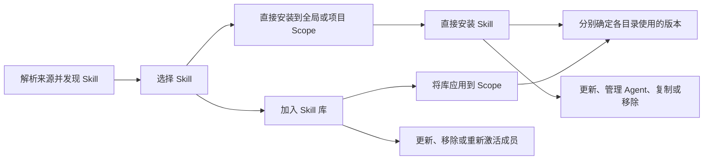

# Skill 生命周期

## 生命周期概览

Skill Deck 将包含 `SKILL.md` 的完整目录作为一个 Skill。目录还可以包含脚本、参考资料、资源文件、隐藏文件、嵌套目录和可执行文件。

从来源取得的 Skill 可以直接安装到全局或项目 Scope，也可以加入 Skill 库。直接安装 Skill 由所在 Scope 管理；库成员由所属库独立维护，通过库应用关系提供给各个 Scope。

本文件维护直接安装 Skill、库成员和库应用的业务规则。用户入口与反馈见[产品行为与交互](./product.md)，内容快照、事务和恢复协议见[执行与恢复](./execution-and-recovery.md)。

## 从来源发现 Skill

一个来源可以提供一个或多个 Skill。Skill Deck 支持以下输入：

- GitHub 简写、GitHub 或 GitLab URL，以及仓库中的 Skill 路径；
- 带分支、标签或 Skill 筛选条件的 Git 来源；
- SSH 和其他可以通过 Git 获取的地址；
- 当前 Environment 中的本地目录；
- Well-known 地址；
- 原始 `SKILL.md`、ZIP、tar 或 tar.gz 文件的 HTTP 或 HTTPS 地址；
- 能够解析出来源、Skill 和 Agent 选择的受支持 `skills add` 命令。

应用先解析并获取来源，再列出有效 Skill。用户完成选择后，应用固定所选 Skill 的完整内容并生成预览。来源获取失败时停止当前流程；内容或预览过期后，需要重新获取并确认。来源发现只依赖 Environment，后续预览使用流程已经选定的安装位置或目标库。

### 目录发现与选择

首次从已经获取的目录中发现 Skill 时，遵循以下顺序：

1. 来源根目录本身是有效 Skill 时，只返回根 Skill。
2. 在 `skills` 和 Agent 专用 Skill 目录等已知容器中向下搜索三层，遇到包含 `SKILL.md` 的目录后不再进入其子目录。
3. 对来源根目录和插件清单声明的目录，只检查直接子目录。
4. 优先位置没有得到可安装 Skill 时，在来源目录的五层范围内继续查找。

刷新 Git 来源证据或为更新重新获取内容时，应用按照已保存路径直接定位 Skill，不因普通发现深度或来源根目录也是 Skill 而提前结束。来源目录结构和容量限制见[更新检查](./update-checking.md#如何获取远端版本信息)。

普通发现和通配选择只展示公开 Skill。用户通过来源语法或命令明确指定名称，且选择中不包含通配符时，列表会额外包含同名的内部 Skill（`internal`）；其他内部 Skill 继续隐藏。Git、本地目录、直接下载和 Well-known 来源使用相同规则，后续内容获取只接受本次发现结果中的 Skill。

来源解析、发现顺序和记录格式的兼容约束见[skills CLI 参考与兼容](./skills-cli-reference.md#来源解析与发现)。

### Well-known 与直接下载

普通 HTTP 或 HTTPS 地址先按 Well-known 来源解析：

| 输入形式 | 读取规则 |
|---|---|
| 站点根地址 | 读取站点根目录的 Skill 索引 |
| 带页面路径的地址 | 读取该路径范围内的 Skill 索引；站点根索引仅用于判断是否存在范围不匹配 |
| 以 `index.json` 结尾的精确地址 | 只请求该索引 |

带页面路径的地址称为 scoped 地址。该路径没有可用 Skill、但站点根索引有效时，应用返回范围不匹配错误并停止获取。站点没有可识别的 Well-known 索引时，应用继续尝试直接下载原地址。托管平台明确表示文件或归档的地址直接进入下载流程。

直接下载只支持没有同名冲突的全新安装。目标已经存在同名 Skill 时，应用停止安装并提示冲突；安装后不创建来源 lock，也不提供更新入口；再次安装前需要先移除现有 Skill。用户仍可管理 Agent、复制或移除本地内容。

直接下载发生跨主机重定向时，用户需要在确认页确认最终主机。来源内容的大小、摘要和解包校验见[执行与恢复](./execution-and-recovery.md#skill-内容快照)。

### 获取失败

Git 来源获取与远端引用查询共用 Git 获取超时设置，排队等待其他获取任务的时间不计入该时限。来源获取失败时，应用区分超时、网络连接、认证、仓库不存在、引用不存在和其他 Git 执行失败，并保留有界的本地诊断。

代理、进程监督和日志边界见[系统架构](./architecture.md#外部网络访问)，用户设置和进度反馈见[产品行为与交互](./product.md#git)。

## 安装

一次直接安装需要确定操作位置、Skill、Agent 安装选项、链接或复制方式，以及覆盖内容和来源风险所需的确认。操作位置在安装流程中固定；主窗口随后切换 Environment 或项目，都不会改变该目标。

读取通用 Skill 目录的 Agent 可以直接发现其中的 Skill。用户选择 Agent 安装选项后，应用在对应的 Agent 专用 Skill 目录中创建链接或副本。读取方式、目录分组、未知 Agent 和 Eve 专用目标的规则见[Agent 模型](./agent-model.md#agent-选择与安装位置分组)。

Scope 已经应用同名库成员时，安装会按[库应用与版本选举](#库应用与版本选举)更新相关目录。未选择直接安装的 Agent 专用目录可以继续使用原有库版本。

批量安装按 Skill 分别返回结果。一个 Skill 失败时，已经成功的 Skill 保持不变，其他可继续的任务仍然执行。

## 已安装状态与读取

直接安装 Skill 由 Environment、Scope 和 Skill 名称共同标识。来源不是其身份的一部分，也可以缺失。同一直接安装可以存在于通用目录、Agent 专用目录或多个位置，通用目录可以不存在。

Skill 目录提供当前内容，来源记录提供重新获取和更新依据。目录存在但没有对应来源记录时，应用将其作为本地 Skill 展示；用户仍可查看和管理内容，该 Skill 不参与更新检测，也不显示来源异常。来源记录存在但字段不完整或无法解析时，应用显示“来源信息不完整”；来源记录存在但目录缺失或不可读取时，应用显示对应目录异常。

普通 Skill 使用 `SKILL.md` 中的原始名称标识，经过安全化的名称用于实际目录。Eve 的派生内容依据明确的项目来源记录匹配实际位置，保留原始文件格式；匹配不明确时报告诊断。旧来源记录的名称匹配与迁移规则见[skills CLI 参考与兼容](./skills-cli-reference.md#skill-deck-修改-lock-文件)。

读取内容时，后端根据 Skill 标识重新解析目录并校验路径。默认内容优先取自可用的通用直接版本，否则从实际直接安装位置稳定选择一处。库归属按物理位置确认，覆盖活动和退役成员；同名库版本不会隐藏其他位置的直接版本。默认阅读位置只用于展示，复制源和更新目标各自按业务规则确定。资源访问边界见[系统架构](./architecture.md#安全保证)。

## 更新

更新检查使用保存的来源信息和本地版本基线，执行更新使用已经准备并确认的完整内容。检查结果与本次检查状态分别展示。

本地来源不参与远端更新检查。缺少版本基线时无法比较远端版本；保存的来源仍足以定位内容时，可以通过现有更新入口按来源重新获取。Skills 页检查和更新所选 Scope 的实际直接安装，库页面处理当前库成员，两者分别使用各自基线。比较方式、缓存、失败重试和凭据规则见[更新检查](./update-checking.md)。

更新按整份 Skill 发起，先获取内容并固定实际目标，再由用户确认。通用直接内容固定更新；普通独立副本默认选中并允许取消。只有专用目录安装时在原位置更新，并合并同一物理目录的选择。内容不同或无法建立一致基准的副本默认不选，由用户明确确认覆盖。链接选择状态跟随目标内容，链接本身不重建；独立外部引用不更新，同名库版本继续由库维护。

项目更新以实际解析后的项目根判断维护范围。项目根别名和项目内目录链接保持有效；父目录链接使内容落到项目外时，保留外部内容与链接，其他合法位置继续。差异覆盖仅适用于本 Scope 内已确认可写的位置。全局更新继续使用声明的 Home、ConfigHome 和自定义绝对目录，不以 Home 前缀限制所有全局位置。

更新保持已有目录布局和 Agent 关联，普通缺失位置不补装。已有可识别安装、且项目记录明确指定其他 Eve 位置时，预览可以列出缺失 Skill 目录的恢复动作；确认后与现有位置一起更新。恢复要求 Eve 目标根仍可验证，不重建 Agent 定义，也不只凭全空的残留记录生成恢复入口。

Eve 更新使用准备阶段生成并校验的目录型派生内容。必要目标包含单文件安装、不可读取位置或不安全条目时，整份 Skill 无法进入确认集合；独立且安全的其他 Skill 可以继续。明确属于库版本的位置及其故障由库维护。

确认后全部位置均保留时，不执行目录写入或提交来源记录。任何目标在准备后发生变化，包括原先缺失的通用目录或 Eve 备选位置被占用，都会使相应计划失效。事务与结果语义见[执行与恢复](./execution-and-recovery.md#预览与执行)。

执行只接受当前预览签发的可选副本标识，未选中的副本保持原内容。成功写入后，来源记录仍按 Skill 更新，不保存各位置独立的来源版本；结果明确列出未更新副本。详情页可再次按同一来源准备更新，不要求远端出现新的版本。

准备时已无可写位置的 Skill 只返回保留信息，不获取无用的来源内容；批量结果将其记为未执行。更新规划同时观察目录路径经过的链接，确认后链接被改指时停止对应 Skill，避免使用已经失效的维护范围。

来源记录不完整、来源失效或来源中已经不存在当前 Skill 时，本地内容继续保留。用户可以保留或移除当前 Skill；需要从其他来源重新安装时，先移除当前 Skill，再使用普通安装流程。

## 管理 Agent

管理 Agent 调整直接安装 Skill 与 Agent 专用目录的关联。勾选项表示该目录是否使用直接安装版本，与目录当前是否能通过库取得同名 Skill 分别计算。

- 选中安装选项时，在相应目录中创建或更新直接安装项。
- 取消安装选项时，其余直接安装位置继续保留；所选专用目录按当前库应用关系恢复库版本，或者移除该直接安装项。
- 多个 Agent 使用同一实际目录时，应用只执行一次文件变更。

目录中仍可使用哪些版本，由[版本选举规则](#库应用与版本选举)确定。Agent 检测只影响提示和推荐，实际写入目标由用户确认的安装选项决定；选择界面规则见[Agent 模型](./agent-model.md)。

仅取消关联时不获取源内容。新增关联使用符合下文复制源要求的实际内容；没有合格的通用目录链接目标时，提示用户选择复制方式，原有目录布局继续保留。

## 复制到项目

复制入口用于项目中已经直接安装的 Skill；全局 Skill 通过安装流程进入项目。用户选择一个或多个目标项目，并为同一个目标 Environment 中的项目使用一套 Agent 安装选项和安装方式。

复制读取当前 Skill 的完整目录并固定内容快照，不重新访问远端来源。存在合格通用直接版本时优先使用它；否则要求实际来源唯一，或多份同形态内容一致。来源有歧义时停止复制。写入普通 Skill 目录前校验必需元数据，Eve 派生内容不会被补写名称或隐式转换为普通格式。

复制固定所选源的位置、物理身份和内容，执行前复核同一位置；源变化后需要重新准备。跨 Environment 复制由目标 Environment 完成写入，项目访问条件见[Environment、Skill 位置与项目管理](./environments-and-projects.md#把-skill-复制到其他项目)。

来源记录作为可选信息随内容复制：

| 来源状态 | 目标项目的结果 |
|---|---|
| 来源记录完整 | 保存独立记录，并按该来源判断更新能力 |
| Well-known 来源 | 保留可用的索引地址和版本摘要，具体制品地址不作为索引 |
| 本地来源 | 保留来源含义，不增加远端更新能力 |
| 来源缺失或无法解释 | 只保存内容，不创建来源记录 |

复制为每个目标 Scope 独立规划目录变化，保留目标已有的其他 Agent 安装关系。新增直接安装项使用本次选择的链接或复制方式，其余目录按统一版本选举规则处理。

每个项目分别返回结果，一个项目失败时其他项目仍可继续。源 Skill 的内容、来源记录和更新能力不受复制结果影响。

## 移除

移除会撤销当前 Scope 中的直接安装 Skill，并清理本次操作负责的本地记录。通用目录和相关 Agent 专用目录按当前库应用关系重新选择版本；存在适用的同名库版本时，在同一个受保护计划中恢复该版本。

这项操作处理整个直接安装 Skill。用户需要保留它、只调整部分 Agent 时，通过“管理 Agent”完成。移除范围和确认反馈见[产品行为与交互](./product.md#移除-skill)。

## 库成员生命周期

每个 Skill 库独立保存成员内容和来源记录。同一 Skill 可以加入多个库；修改其中一个库的成员，不会修改其他库中的副本。

### 添加成员

库添加流程复用来源解析、发现和内容校验。流程固定 Environment、目标库和已选成员，再生成绑定当前库状态的预览。当前库已有的同名成员不能重复添加。

添加结果按 Skill 返回。部分失败后，只对失败或尚未执行的成员重新预览和执行；先前的成功结果继续保留。跨主机下载需要用户确认最终主机。

### 更新内容

库成员以 `SKILL.md` 中的名称作为身份。更新按原来源重新获取完整内容，名称必须保持不变；名称变化或来源已无法定位成员时，保留原内容，用户可以移除旧成员后添加新的 Skill。

整库更新检查只比较版本，不修改成员内容。用户确认更新后，应用按等价来源合并获取请求，再逐个成员提交。获取期间库根目录、成员内容或来源记录变化时，只停止受影响的成员。具体比较方式，包括旧版 Well-known 索引的内容下载，见[更新检查](./update-checking.md)。

同名内容更新保持成员身份和存储目录稳定。已经应用该库的位置通过原链接读取新内容，无需重新建立应用关系。

成员的更新时间表示 Skill Deck 最近一次成功提交本地内容的时刻。失败或回退保留原时间；旧成员缺少时间记录时，应用在下一次成功提交后补充，不根据文件时间或来源发布时间推测。

### 移除与重新激活

从库移除成员时，应用先将它标记为退役，使它退出可用成员集合，原内容暂时保留。相关 Scope 随后重新选择同名版本，可能改用其他库版本，也可能移除已识别的库链接。

再次向同一个库添加同名退役成员时，沿用原身份和存储目录，并通过成员事务写入新内容。其他名称即使映射为相同目录名，也不能占用退役成员的目录。

应用能够核实全部应用记录，并确认已完成状态、未完成操作和恢复数据都不再引用该成员后，才会清理退役内容。条件不足时保留内容和记录，后续维护可以继续检查。清理的条件提交和失败恢复见[执行与恢复](./execution-and-recovery.md#库内容事务)。

删除整个库要求先解除全部应用关系，并完成仍引用该库的未决调整。引用盘点不完整时，删除和退役清理保持不可用。

## 库应用与版本选举

### 应用关系

用户可以在同一 Environment 的全局或项目 Scope 中选择多个库，并调整它们的优先顺序。一个 Scope 应用的所有库共用一组 Agent 专用目录选择；可选 Agent 的条件见[Agent 模型](./agent-model.md#skill-库的-agent-选择)。

空库也可以应用。应用关系保留库顺序和 Agent 选择，库以后加入成员时，相关 Scope 会继续同步。库数据归属和可访问目录的限制见[Environment、Skill 位置与项目管理](./environments-and-projects.md)。

### 每个目录独立选择版本

同名 Skill 在每个实际目录中分别进行版本选举：

| 目录 | 直接安装版本何时优先 | 没有适用的直接安装版本时 |
|---|---|---|
| 通用 Skill 目录 | 该目录已有直接版本，或本次操作明确在该目录安装直接版本 | 按应用库顺序使用第一个同名库成员 |
| Agent 专用 Skill 目录 | 直接安装 Skill 已关联该目录 | 在应用到该目录的库中，使用顺序最靠前的同名成员 |

没有任何适用版本时，目标结果是不保留该 Skill。多个 Agent 共用一个物理目录时，合并判断并只更新一次；任一关联要求直接安装版本时，该目录使用直接安装版本。Agent ID 用于说明读取者和操作影响，不决定优先级。

例如，通用目录和 Agent A 的专用目录可以使用直接安装版本，而只关联库的 Agent B 继续使用库版本。取消 Agent A 的直接关联后，它的专用目录恢复适用的库版本，通用目录中的直接安装 Skill 继续保留。

直接安装、复制、移除、调整 Agent 关联、应用或取消应用库，以及调整库顺序，都会重新计算受影响目录。直接安装版本优先期间，库应用关系继续保存。

### 现有目录与归属

系统先识别指向已知库成员的链接。其他有效 Skill 目录、符号链接或 Windows 目录联接（junction）作为对应目录中的直接安装版本保留；现有记录不能证明这些安装项由哪个工具创建。

失效链接在存在可用目标版本时可以替换。文件等无法作为 Skill 目录处理的条目会阻止该目录更新，并报告相关 Skill、Agent 和路径。目录已经符合选举结果时只复核状态，不重复写入；具体安全协议见[执行与恢复](./execution-and-recovery.md)。

### 成员同步与继续处理

库成员新增、退役和重新激活前，应用预览所有已知 Scope 的版本变化，将无法访问的位置标记为未验证。用户确认后，应用提交成员变化，再按 Scope 分别同步；一个位置失败，不撤销其他位置已经完成的结果。

同步只处理本次变化以及此前尚未完成的成员。连续操作即使最终恢复原成员集合，也要处理其间已经受影响的目录；其他成员被用户修改的链接不会顺带修复。

系统保存已经确认但尚未完成的操作。应用启动后的维护和用户手动重试会重新规划这些操作；已同步且没有待办的位置直接结束检查。取消、未验证和需要恢复分别返回，不把普通检查失败转换为新的写入任务。

用户可以主动重新应用当前库配置，修复缺失或失效的受管理链接。重新应用保留有效的直接安装版本和无法确认归属的内容；仅打开页面或启动应用不会自动修复用户在外部修改的目录。

单个 Scope 的执行结果、待处理记录和恢复机制见[执行与恢复](./execution-and-recovery.md#库应用事务)。
